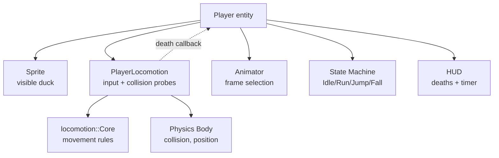
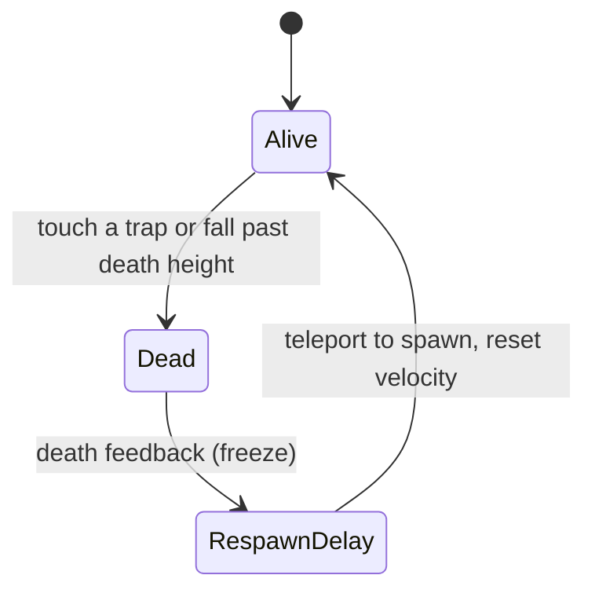
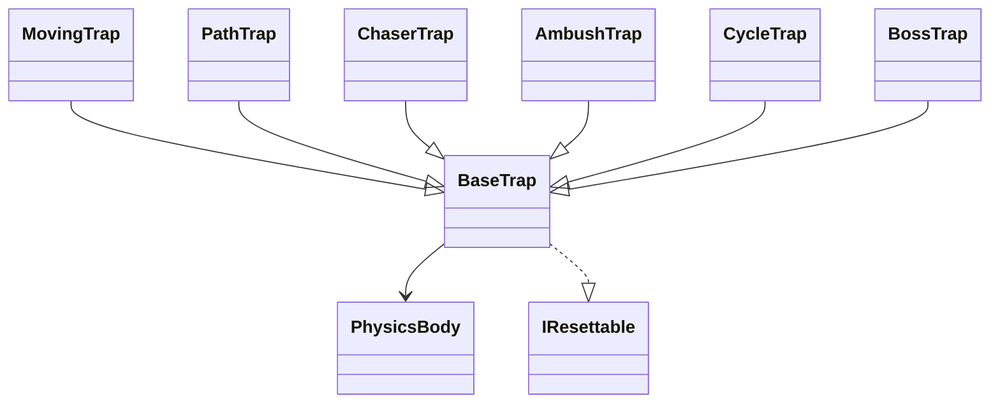
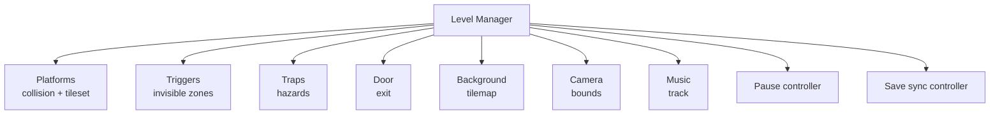
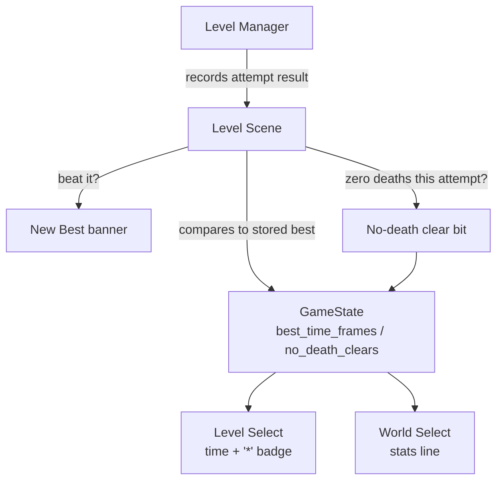

# Components

This page gives a **conceptual deep-dive** into the three largest gameplay
systems: the **Player System**, the **Trap System** and **Level Management**,
plus the smaller **Progress Feedback** and **Audio System**. Each section
describes responsibilities, states and interactions, with the names of the
files that hold the rules. For the high-level view see
[Project Architecture](architecture.md).

---

## 5.1 Player System

The player is the duck. It is built by **composition**: a top-level entity that
owns several focused collaborators.



### Player states & capabilities

The state machine tracks four coarse movement states that the animator reacts
to:

| State | Meaning |
|-------|---------|
| **Idle** | Standing still on the ground (a static frame, or facing back). |
| **Run** | Moving horizontally on the ground (alternating walk frames). |
| **Jump** | Rising after a jump. |
| **Fall** | Descending. |

Locomotion also tracks a **facing** direction (forward, back, left, right) for
the animator.

### Movement mechanics

The movement rules live in `locomotion::Core` (`locomotion.h`), which has no
Butano dependency and is host-tested (`tests/host/test_locomotion.cpp`).
`PlayerLocomotion` is the adapter: it reads the buttons into an `InputState`,
answers the core's collision probes (ground, ceiling, left/right wall, pogo
box) from the physics body, and turns the returned `Effects` into sounds and
`PlayerEvents`. One `Core::step()` per frame:

1. Store the jump input in the jump buffer.
2. If a [dash](#dash) is running it owns the frame; the steps below are skipped
   except the fall-death check and the ground-state update.
3. Horizontal input: accelerate up to the max speed; brake with
   `DECELERATION`.
4. Jump handling with **coyote time** and **jump buffering**; wall slide and
   wall jump; pogo strike.
5. Gravity; **variable jump** (releasing A early ends the rise); clamping of
   horizontal and fall speed.
6. **Bounds**: the duck bounces off the world's left/right edges (set per level
   from the world width).
7. **Ground state** from the probes, and the **death check**: falling below
   `Cfg::Player::DEATH_HEIGHT` raises a death.

The tuning values (acceleration, max speed, jump speed, gravity, fall clamp,
coyote/buffer frames, death height) live in `Cfg::Player` (`cfg.h`) so the feel
can be tuned in one place for every stage.

### Dash

The dash rules live in `DashController` (`dash_controller.h`, Butano-free,
host-tested), tuned by `Cfg::Dash` (`cfg_dash.h`). `Core::_update_dash()` fills
a `DashInput` from the frame's input and environment, calls `update()` and
applies the returned `DashStep`.

- **Start.** B pressed, dash enabled for the level, air dash charge available,
  cooldown elapsed. Direction is the held D-Pad direction, else the facing.
- **Motion.** `vel_x = ±SPEED`, `vel_y = 0` for `DURATION_FRAMES`.
  `PhysicsBody::move_velocity()` clamps by magnitude, so `SPEED` must stay
  below the player's `vel_max`.
- **End.** Timer elapsed, a wall zeroed `vel_x`, the world's bounce edge was
  reached, or a buffered jump on the ground (dash-jump). Normal movement
  resumes the same frame at walking top speed, and the cooldown starts.
- **Charge.** The air dash is refilled by a real ground probe hit, never by
  coyote time. `DashController::land()` ignores the call while a dash runs, so
  a dash started on the ground cannot refill itself.
- **Reset.** `Player::death()` and every level load call `reset_dash()`.
- **Enablement.** `LevelManager::_load_player_spawn()` enables it when the
  loaded level is at or beyond the start of `Cfg::Dash::UNLOCK_WORLD` (via
  `WorldIndex::WORLDS`). No save field is involved. The pogo and the wall jump
  are enabled the same way from their own `UNLOCK_WORLD`; the pogo also in
  every level that has a BOSS trap.
- **Animation.** While dashing the animator gets "not on ground", so the jump
  pose plays.
- **Feedback.** Starting a dash plays `bn::sound_items::dash`. `Player` leaves
  afterimage ghosts: `DashTrail` (`dash_trail.h`, Butano-free) decides when a
  ghost spawns (every second dash frame), which of its 4 slots it takes, how
  long it lives (6 frames) and when it is drawn (odd remaining life only, so it
  flickers without touching the blending setup the scene fades use). Each slot
  is a `Sprite` copy of the duck's current frame registered with
  `SpriteRegistry`, one z-step behind the duck. Ghosts are cleared on death,
  when the duck is hidden for a menu, and when a level ends.

### Pogo and wall jump

Both live in `locomotion::Core`, tuned by `Cfg::Pogo` (`cfg_pogo.h`) and
`Cfg::WallJump` (`cfg_wall_jump.h`); the player-facing rules are in
[Game Concepts](game-concepts.md#pogo). The pogo strike asks the world for
`probe_pogo()` (a trap in the strike's box below the duck); a hit bounces the duck and
refills the air dash, and a boss is also told it was struck
(`strike_targets.h`). The wall slide/jump asks for
`probe_left()` / `probe_right()` and is only probed with wall jumps enabled.

### Ground friction

Speeding up and braking are separate constants (`Cfg::Player::ACCELERATION`
and `DECELERATION`). Braking is also the one movement value a level can
override: `LevelData::ground_friction` (default `1`) scales `DECELERATION`
only, applied via `Player::set_ground_friction()` when the level loads. Below
`1` the floor is slippery (`LEVEL_3` and `LEVEL_WORLD3_SCROLL` use `0.55`).
Because acceleration, gravity and jump speed are untouched, it cannot change
how far a jump reaches. See
[Level Design - Platform placement principles](level-design.md#platform-placement-principles).

### Death & respawn system



- A **trap collision** or **falling past the death height** triggers a death.
- The **death counter** increments and the **save-sync** system persists the
  total.
- The level manager puts every trap and trigger back to its starting state
  through the shared **resettable** interface.
- With a **checkpoint** reached, the respawn point is that flag (see
  [Checkpoints](#checkpoints)).
- Whether *any* death occurred during the current attempt is tracked separately
  from the running total, feeding the **no-death clear** record (see
  [Progress Feedback](#54-progress-feedback)).

Locomotion does **not** own respawn logic. It raises a death through a small
**callback interface** (`PlayerDeathHandler`) and the player entity handles the
rest.

#### Death feedback

The respawn is instant in the data, but the player sees a short sequence
(`death_fx.h`, Butano-free and unit-tested, tuned by `Cfg::DeathFx` in
`cfg_death_fx.h`). `level_flow::check_player_died()` spots a new death right
after the physics step:

- **Hitstop.** The world freezes for 6 frames: no physics, traps, camera
  movement, level clock or run timer, so the feedback never costs record time.
  The duck is hidden and `Player::begin_death_fx()` leaves a copy of its last
  frame where it died (a `Sprite` registered with `SpriteRegistry`). The trap
  that killed it stays where it is: the entity reset is deferred until the
  freeze ends.
- **Screen shake.** The picture shakes for 14 frames, starting at 3px and
  fading out. `Camera::set_shake()` offsets every sprite synced through the
  camera; the HUD and the screen-locked background stay put.
- **Respawn.** When the freeze ends the ghost goes, the duck reappears at the
  respawn point, traps and triggers are re-armed and the camera cuts to the
  duck. The duck then flickers for 18 frames. That is **visual only: no
  invulnerability.**

Restart Level from the pause menu is a death on purpose and skips all of this:
`level_flow::restart_level()` takes and saves its one death right away and sets
up the next attempt before the physics step of that frame. `respawn::when()`
(`respawn_logic.h`, host-tested) decides: a death waits for the end of its
freeze, Restart Level is set up at once. Pausing during the freeze stops it,
and loading or unloading a level cancels it (`Player::cancel_death_fx()`). A
fall past the death height gets the same freeze and shake.

### HUD components

The player owns an HUD with a **death counter** and a **run timer** (minutes,
seconds, centiseconds, driven by a frame counter without expensive division).
It has a visibility toggle so title screens and the kiss scene can hide it.
Timer digits only update when their value changes.

---

## 5.2 Trap System

Traps are the hazards. They share a **base trap** and specialize through
subclasses chosen by the **trap factory** (`trap_factory.h`) at level load.



### Base responsibilities

The base trap owns a **collision volume** linked to a sprite (position, size,
offset); **collision with the player** (the duck dies and the hit sound plays);
an optional looping **sprite animation**; and **sprite registration** with
`SpriteRegistry`.

### Trap categories

| Category | Activation | Movement | Purpose |
|----------|-----------|----------|---------|
| **Base** | Always active | None | Static obstacles that punish careless landing. |
| **Moving** | Trigger-linked | Accelerates once triggered | Timed hazards released mid-run. |
| **Path** | Trigger-linked | Interpolates along waypoints | Patrols, sweeping hazards. |
| **Chase** | Watches the player | Closes the gap when the player advances | Pressure that punishes hesitation. |
| **Ambush** | Watches the player (proximity) | Lunges once, then returns | Disguised hazards. |
| **Cycle** | Own clock (optionally trigger-gated) | Out, hold, back, rest - on repeat | Rhythm hazards (spikes from the floor). |
| **Boss** | Trigger `arena` | Path across the pit, faster per phase | The one beatable enemy, see [Game Concepts](game-concepts.md#bosses). |

- **Base traps** stay where they are placed; their sprite may animate.
- **Moving traps** start dormant. When their trigger fires they accelerate in a
  configured direction up to a maximum velocity. Respawn returns them to the
  start and re-arms them.
- **Path traps** follow waypoints relative to their origin, waiting a
  configured number of frames on each node.
- **Chase traps** bypass normal physics: they drift rightward to keep a
  configured distance behind the player, up to a maximum speed. They only move
  right, so the duck must keep moving. `chase_limit` stops them before a boss
  arena.
- **Ambush traps** stay motionless (optionally animating) until the player
  comes within a configured range, lunge once for a fixed duration (along x, or
  along y with `ambush_vertical`; `ambush_logic.h`), ease back and re-arm.
- **Cycle traps** run a fixed timeline (`trap_timing::CycleTiming`, pure and
  unit-tested: `cycle_progress()` returns how far out the trap is in permille,
  `next_cycle_frame()` wraps the round without a division). `CycleTrap` turns
  that into a position (`start + (dx, dy) * permille / 1000`), writing `pos`,
  `shape_pos` and the sprite directly like `PathTrap`, and starts
  `cycle_phase_frames` into its round. An optional trigger gates it: while off,
  the trap stays where it is and its clock stands still. The factory scales the
  five frame counts by the Hard/Assist multiplier and refuses a round of zero
  frames at load time.
- **Fakes** are ordinary BASE traps wearing the sprite of a door or checkpoint.
  `TrapData::sprite_z_order` (any trap type) is applied by
  `TrapFactory::create()` through `BaseTrap::set_sprite_z_order()`, so the fake
  stands behind the duck like the real one.
- **False exits** are the real door lying (`door_logic.h`, pure, host-tested in
  `tests/host/test_door_logic.cpp`). `on_touch(reached, locked, trapped, died)`
  turns a touch into `Finish`, `Kill` or nothing (a boss-locked door does
  neither; a duck a trap already caught this frame is not killed twice).
  `trapped()` reads the `DoorData::trap_trigger_name` trigger that
  `LevelManager` looks up after loading the triggers; it is left out of the
  checkpoint snapshot via `CheckpointRun::forget_trigger()`, which is why
  `Check_trigger_references.py` rejects a trap trigger that follows another one
  or that anything else uses. `attempt_offset()` picks the door's spot from
  `DoorData::attempt_positions` with `attempt_variant::variant_for_attempt()`;
  `Door::place_for_attempt()` places it on load and in every respawn.
  `level_flow::check_door_trap()` runs right after the collision update, before
  `check_player_died()`, so a door that kills starts the death feedback like a
  trap does. The door keeps no tell: its sprite never changes.

### Activation mechanisms

- **Trigger-linked.** Moving, Path and Cycle traps reference a trigger by name.
  When the trigger turns on, every trap bound to that name starts.
- **Direct player tracking.** Chase and ambush traps read the player's position
  every frame: chase continuously, ambush only to test a proximity threshold
  before a self-contained lunge.

### Trigger modes and switched platforms

`Trigger` keeps its state in a `TriggerState` (`trigger_logic.h`, Butano-free
and unit-tested). The mode (`TriggerData::mode`) decides what an entry or exit
does: **Latch** (default), **Toggle** (flip on every entry), **Hold** (on while
inside) or **Timer**. `Trigger` is resettable and registered in the level
manager's resettable list, so a trigger that drives only platforms still resets
on death. An optional sprite (`TriggerData::sprite` plus an off and an on tile
index) is wrapped in `Sprite`; both tile sets are created up front, so a state
change is a tile swap.

`TriggerState` also carries the delay and the timer. `triggered()` is what
traps and switched platforms read; `pressed()` is what the duck caused and what
a visible switch shows. With `delay_frames` > 0 the first follows the second
after that many frames (a change undone in time never shows); a Timer trigger
sets itself `delay_frames` after the last `reset()`. `Trigger::update()` runs
`TriggerState::tick()` through `CollisionRegistry::update_all()`, so both stand
still while paused or frozen by the death feedback. A checkpoint respawn
restores a snapshot immediately (`TriggerState::restore()`).

A trigger with `TriggerData::action` Jump or Dash fires from `update()` instead
of the overlap callback: `on_enter()` / `on_exit()` only track whether the duck
is inside, and `action_fires(action, inside, jumped, dashed)` decides each
frame whether the duck's jump or dash counts as an entry. The events come from
`PlayerEvents` (`player_events.h`, a Butano-free singleton):
`PlayerLocomotion::update()` ends the previous frame's events with
`begin_frame()` and notes a jump or dash when one really starts;
`LevelManager::_load_player_spawn()` clears them on level load. An event stays
readable until the player's next update, so every trigger sees it exactly once
whatever the order of the collision shapes.

**Delayed trap chains.** A trigger with `TriggerData::follows` is built as a
*follower*: `on_enter()` / `on_exit()` and its own mode do nothing, and
`follow(source_active)` presses it or releases it - only a change starts its
delay. A follower follows whether its source is **activated** (`triggered()`
differs from the source's `default_on`): the first `capture()` after `clear()`
(level load) takes every trigger's state as its default. The links live in
`TriggerChains` (`trigger_logic.h`, tested in `tests/host/test_trigger_chain.cpp`):
`_load_triggers()` resolves each `follows` name to an index once every trigger
exists. Every frame, right after the collision update,
`propagate()` hands each follower its source's state **of the previous frame**
and then takes the new one. So every hop costs exactly one frame plus the
follower's delay, independent of array order and chain length, and a cycle of
followers can neither fire nor loop. The respawn calls `capture()` after the
reset and the checkpoint restore, so nothing from before the death reaches a
follower. That relies on a fired follower being *on* (the snapshot only
switches triggers back on), so `Check_trigger_references.py` rejects a follower
with `default_on: true`.

Platforms bind to a trigger through `PlatformData::trigger_name`. After the
triggers load, the switched platforms are handed to `DynamicPlatforms`
(`dynamic_platforms.h`, host-tested). Every frame after the collision update
`sync_switched()` compares `switch_logic::platform_active(trigger_on,
active_when_on)` with the body's enabled state and enables or disables body
and sprite together. A platform about to re-appear is held back while its box
overlaps the duck's (`switch_logic::boxes_overlap()`), since the duck would be
stuck.

### Trigger lookup

A trigger can carry a stable name (`TriggerData::name`); a trap binds to it via
`TrapData::trigger_name`, resolved through
`LevelManager::get_trigger_by_name()`. Named lookup is a linear scan over at
most 16 triggers, once per trap at level load. One trigger can activate several
traps: give each the same `trigger_name`, as `level0_traps` in
`game/levels/world1.json` does. See the
[Extensibility Guide](extensibility.md) for how to author a trigger.

### Interactions with the player

Traps belong to a **trap layer** the player subscribes to; when the player's
body overlaps a trap, the trap's handler kills the player. The same collision
framework lets platforms block the player, triggers sense it without being
touched back, and doors signal completion.

### Reset model

Every trap and trigger implements the **resettable** interface. On player death
or a manual restart, the level manager walks its resettable list and resets
each. This keeps respawn deterministic - unless the level asks for a different
layout (see [Death windows](#death-windows-level-devil)).

### Hard Mode speed scaling

Moving, Chase and Ambush traps read a speed multiplier from the level manager
at construction (`LevelManager::trap_speed_multiplier()`):
`Cfg::HardMode::SPEED_MULTIPLIER` (1.35) with Hard Mode on,
`Cfg::AssistMode::TRAP_SPEED_MULTIPLIER` (0.5) with Assist Mode on, else `1`
(`modes::trap_speed_mode()` in `game_modes.h` decides; Hard Mode wins if both
flags were ever set). The multiplier is applied once in the **trap factory** to
the velocity/speed parameters, never to the level data. Path and Cycle traps
are scaled too, but their pacing is a frame count, so the factory divides it:
`trap_timing::scaled_frames(frames, speed_percent)` (`trap_timing.h`,
Butano-free and unit-tested) rounds to the nearest frame, never turns a
non-zero count into 0 and leaves 0 alone. With x1.35 a 15-frame node becomes 11
frames, with x0.5 it becomes 30.

Because scaling happens at construction, a toggle takes effect the next time a
level loads. See [Game Concepts - Hard Mode](game-concepts.md#hard-mode).

### Assist Mode

Assist Mode reuses that plumbing. Additionally
`LevelManager::_load_player_spawn()` calls `Player::set_assist_mode()`, which
swaps the coyote and jump-buffer windows to `Cfg::AssistMode` values (8 and 12
frames). Jump speed, gravity and acceleration are untouched, so the physics
envelope level layouts rely on does not move. The two modes are mutually
exclusive: `modes::toggle_hard_mode()` / `toggle_assist_mode()`
(`game_modes.h`) keep them so.

Assisted runs do not set records: `LevelManager::records_allowed()` is false
when Assist Mode was on at level load or is on now (so a mid-level toggle
cannot launder a run), and `LevelScene::update()` then skips the best-time and
no-death-clear bookkeeping and the "New Best!" banner. Advancing and unlocking
are unaffected.

### Pause menu views

The pause controller has three views: the main menu (Continue / Restart Level
/ Options / Controls / Title Screen), the Options sub-menu and the Controls
overview. The latter two replace the menu in place rather than switching
scenes - leaving the level would destroy it. The Controls view draws
`ControlsText` (shared with the start-screen `ControlsScene`) and returns on A
or B. List cursors wrap via `menu_nav::next_index()` / `prev_index()`.

The overlay's sprites are created when the game pauses and released - not just
hidden - when it resumes, restarts or goes to the title: Butano counts hidden
sprites like visible ones, and the overlay needs up to ~63 of the 128 hardware
sprites. The Controls view drops the title as well.

---

## 5.3 Level Management

The **level manager** is the stage's runtime container. It owns everything that
exists *during a stage* and nothing that persists across scenes.



### Resource management

Collections are **fixed-capacity** (`Cfg::Level::Limits`: 32 platforms, 16
triggers, 32 traps, 1 checkpoint) to avoid heap fragmentation. On unload every
resource is explicitly released before the next stage loads, so its assets can
claim the same sprite slots and palettes.

Platform sprites are wrapped in the shared **Sprite** type and registered with
**SpriteRegistry** (capacity 72) at load time, like the door and every trap.
That is what lets them scroll with the camera; a raw sprite handle stays pinned
to its screen position.

### Level lifecycle and order of steps

The order of the steps lives in `level_flow.h`, as templates over a `Host`
(`LevelManager::FlowOps` forwards to the private steps). The order cannot be
seen by the compiler - a misplaced or dropped step silently breaks the game -
so `tests/host/test_level_flow.cpp` plays frames through the same code with a
recording host.

1. **Load** (`level_flow::load()`). Reset the pause controller and the player,
   clear the death feedback, take the attempt's death counts, place the door,
   set music, background and camera bounds, clear the runtime state, validate
   the level against `Cfg::Level::Limits`, create platforms and triggers, look
   up the door's trap trigger, hand switched/crumbling/fleeing platforms to
   their helpers, construct each trap through the factory (with the speed
   multiplier) and add it to the trap and resettable lists, create checkpoints,
   apply the attempt's layout.
2. **Run** (`level_flow::update()`, per frame). Pause handling first; during a
   death freeze only rendering and the freeze run. Otherwise: the level clock,
   the collision update, trigger chains, checkpoints, switched and crumbling
   platforms, fleeing platforms, the boss door, boss hit feel and boss music,
   the fleeing door, the door trap, the death check, the camera, rendering,
   the save sync, and a respawn if a death was saved. The outcome goes to the
   calling scene:
   - **None** - keep running (or paused).
   - **LevelComplete** - the door was reached.
   - **ReturnToTitle** - the player chose "Title Screen".
3. **Reset.** On death or restart the resettable list is walked
   (`level_flow::finish_respawn()`); a death disqualifies the attempt from the
   no-death badge.
4. **Unload** (`level_flow::unload()`). Release sprites, backgrounds and music
   so the next scene starts with a clean pool.

The level manager does not switch scenes. It reports an outcome to the level
**scene**, which asks the **core scene manager** to move on; the scene manager
guarantees the previous stage is torn down before the next one initializes.

### Boss door and music

A level with a `BOSS` trap keeps its door shut (`_sync_boss_door()`) until the
boss is gone. While the duck is in the arena (`boss_fighting()`) the level's
music switches from the world theme to the boss section of the module (made by
`tools/Make_boss_music.py`, `LevelData::boss_music_order`). Boss hits freeze and
shake the world (`_feel_boss_hits()`, `Cfg::Boss`).

### Crumbling platforms

`PlatformData::crumble_frames` makes a platform give way under the duck. The
state machine is `crumble::State` (`crumble_logic.h`, Butano-free, unit-tested):
Solid -> Shaking (solid, `crumble_frames` long, not stopped by stepping off) ->
Falling (not solid, 20 frames of drop animation) -> Gone (not solid, hidden;
back after `crumble_respawn_frames`, or never). `update(standing, blocked)`
returns an event; `DynamicPlatforms` applies it.

Every frame after the collision update `_sync_crumble_platforms()` asks the
player's bottom probe (`probe_bottom(Cfg::Layer::PLATFORM)`) which platform
bodies the duck stands on and steps every state: `Fell` disables the body,
`Vanished` hides the sprite, `Respawned` enables both (only once the duck is
not inside the box). The shake and the fall are the sprite's
`pos.offset_x/offset_y`, so the collision box never moves. The respawn resets
all crumbling platforms, Restart Level included. No new sprites are created.

### Death windows (Level Devil)

`PlatformData` and `TrapData` end with `from_death` / `until_death`: the object
is only there while `attempt_variant::active_for_deaths(deaths, from, until)`
holds. `deaths` is the visit's death count (`level_flow::Attempt::in_level()`:
the run's total minus `at_entry`). `Attempt::enter()` keeps
`GameState::entry_deaths` when `GameState::entry_level` is the level being
loaded (Title -> Continue carries on with the level's deaths), else the run's
total; both are written back on every load and saved with the next death.
`Attempt::layout` starts at that attempt, so a continued level gives no layout
cue. 0, 0 (the default) is always there and such objects are never touched.

Everything is created at load as usual; `_apply_attempt()` then shows or hides
the objects with a window. It runs at the end of the load and in
`finish_respawn()` after the entities are reset, so it covers a death, the
checkpoint respawn and Restart Level alike - and only after the death freeze,
so the trap that killed the duck stays put.

`finish_respawn()` first asks `attempt_objects::layout_changes(level,
attempt.layout, deaths)` (host-tested) whether a window flips or the moving
door stands elsewhere, compared with the layout that was there (not `deaths -
1`: Restart Level during a freeze skips an attempt). If so,
`_cue_layout_change()` plays `bn::sound_items::layout_shift` (generated by
`tools/Generate_dash_sound.py`) and starts a shake without a freeze
(`Cfg::DeathFx::LAYOUT_SHAKE_FRAMES`). Level load and the replay ROM's
`set_deaths_in_level()` give no cue.

- **Traps**: `BaseTrap::set_present()` switches the body, the collision shape
  and the sprite. An absent trap keeps updating invisibly and is reset like any
  other. A BOSS cannot have a window (`Generate_levels.py` rejects it, the load
  asserts it).
- **Platforms**: `attempt_objects::platform_action()` decides: absent -> Hide,
  present -> Show, present and switched -> LeaveToSwitch (a returning switched
  platform still never appears inside the duck). `_load_dynamic_platforms()`
  restarts `DynamicPlatforms` and `FleeingPlatforms` on every respawn and
  registers only the platforms that are there.
- **Checkpoints** are not windowed; the snapshot only restores trigger states.
  `Check_checkpoints.py` keeps a flag off platforms with a window.

Absent objects keep their sprites allocated (hidden), so the sprite budget
counts every copy.

### Checkpoints

`LevelData::checkpoints` lists `CheckpointData {x, y}` entries (center of the
flag sprite = respawn position). `LevelManager::_load_checkpoints()` creates one
`Checkpoint` per entry: a `PhysicsBody` that senses the player on the trigger
layer and raises a flag in `on_enter()`; `take_hit()` hands it to the manager
once. It is deliberately not resettable.

Once per frame `_sync_checkpoints()` asks every checkpoint for its touch and
lets `CheckpointRun` / `CheckpointTracker` (`checkpoint_logic.h`, Butano-free,
unit-tested) decide: only a flag further along than the active one counts. The
new active flag becomes the player's spawn point (`Player::set_spawn_point()`),
its frame switches to the raised green flag, and the manager snapshots which
triggers are on as a 16-bit mask (`pack_flags()`).

After a death the entity reset runs as usual, then the snapshot's triggers are
switched back on via `Trigger::restore()` (`TriggerState::restore()` ignores
Hold triggers). Restart Level calls `_clear_checkpoint()` first: tracker and
snapshot reset, spawn point back to the level's own, flags lowered. Level load
and unload clear everything.

Budget: at most `Cfg::Level::Limits::CHECKPOINTS` (1) per level, one sprite and
one physics body each.

### Level hints

`LevelScene::init()` calls `_show_hint_if_needed()` after the level has loaded.
`hint::should_show()` (`hint_logic.h`, Butano-free and unit-tested) decides: the
level has an `intro_hint` and has not been cleared yet - no personal best
(`best_time_frames[level] == 0`) and `furthest_level <= level` (an Assist Mode
clear records no best time but still advances `furthest_level`). So the hint
needs no save field and ends with the first clear. The text is drawn centered
at `Cfg::Hint::Y`; a `hint::Timer` counts `Cfg::Hint::FRAMES` (300, five
seconds) and B dismisses it early. In a boss level `hint::should_start()` waits
until the duck reached the arena. The hint never pauses or blocks the level.
While paused its sprites are released (`hint::should_draw()`) and the countdown
stands still; `LevelScene` frees them before the call in which Start opens the
pause menu, because the overlay allocates its sprites inside that call, and
draws the hint again on resume.

### Level data organization

A stage is immutable, ROM-resident data (generated from `game/levels/*.json`,
see [Level Design](level-design.md#where-the-level-data-lives)): platforms,
triggers, traps, checkpoints, the background and music, the spawn point, the
door, and the world dimensions (a wider world enables camera scrolling).
Stage contents are data, so designers can add or tune stages without touching
gameplay code - see the [Extensibility Guide](extensibility.md). Hard Mode is a
runtime multiplier, never part of a stage's data.

### Camera systems

The camera is configured per stage from its world dimensions. When the world
matches the screen the camera is static; when it is wider the camera follows
the duck and clamps to the world's edges. The same world width sets the duck's
horizontal bounce boundary.

`LevelManager::_update_camera()` feeds the duck's position and horizontal
velocity into a `CameraRig` (`camera_rig.h`, Butano-free, unit-tested, tuned by
`Cfg::CameraFollow` in `cfg_camera.h`) and hands the result to
`Camera::follow()`, which clamps it to the world:

- **Dead zone (horizontal).** The duck can move 8px either way before the
  camera moves; beyond that the camera moves exactly as far as the duck, with
  no easing, so small steps do not scroll and nothing slides on after it stops.
  Vertically the camera closes 1/8 of the gap per frame and never overshoots.
- **Look-ahead.** It aims 20px in front of the duck in its direction of travel,
  easing in slowly, and keeps that direction while the duck stands still. Only
  a run of 15 frames at 1px/frame or more sets the direction.
  `tests/host/test_camera_view.cpp` checks what the player sees: the real
  movement rules, `CameraRig` and `Camera` together, rounded to pixels.
- **Look up / down.** Holding the D-Pad up or down for 24 frames moves the view
  32px that way and back on release. This only shows in levels taller than the
  screen (`LevelData::world_height` above 160).
- **Cuts.** Level load and every respawn (death, checkpoint, Restart Level)
  cut to the duck instead of gliding.
- **Edges.** The rig clamps its aim to the limits `Camera::follow()` uses
  (`camera_rig::max_offset()`), so turning around at a world edge is followed
  at once.

The background stays screen-locked; only registered sprites move with the
camera.

---

## 5.4 Progress Feedback

Beyond the always-on HUD, a few systems give feedback about progress against
the player's own past runs. All read fields already in the per-slot save state.



### New Best banner

When the door is reached, the level scene compares the attempt's frame count
with the level's stored `best_time_frames`. If it is a new record (including
the first clear) it updates the stored time and holds the scene on a **"New
Best!"** banner (time as mm:ss.cc, "Press A to continue"); it proceeds to the
next level (or the kiss scene on the final level) on A or Start. The banner only
gates the *scene transition*, not whether progress is recorded.

### No-death clears

The save-sync controller tracks whether the death count has changed since the
level was loaded (or since the last restart). If the duck reaches the door with
that count unchanged, the level scene sets a bit for that level in the
`no_death_clears` bitmask (one bit per level, same indexing as
`best_time_frames`). It is a "have I ever done this" record: once set it stays
set, and survives a full-game reset like `best_time_frames`. Level Select
appends a `*` to the best-time readout when the bit is set.

### World-select stats line

Under World Select's list of worlds (locked/unlocked by `furthest_level`) a
single line is computed from the loaded slot at menu build time: the slot's
total **Deaths** and **Cleared** - levels with a non-zero `best_time_frames`
out of the total level count. Nothing new is saved for it.

### Run-complete summary

`SummaryScene` sits between `KissingScene` and `StartScene`. Its `init()` sums
every entry of `best_time_frames`, reads `deaths`, and counts
`has_no_death_clear()` hits. `DataManager::reset()` runs here rather than in
`KissingScene`: `SummaryScene` reads `GameState` while it is still the
finished run's live state and only calls `reset()` once the player presses A or
Start.

### Save-slot preview

`StartScene` previews all three slots by calling `DataManager::peek_state(
slot_id, out)` for each - a wrapper around `SaveManager::load()` that writes
into a caller-supplied `GameState&` without touching the active slot. The read
happens once, in `init()`; moving the cursor only re-renders cached results via
`_rebuild_slot_list()`. Each slot shows "New" if unused, or its furthest world
via `WorldIndex::world_for_level()` (shared with `WorldSelectScene`'s unlock
check).

---

## 5.5 Audio System

Sound has two independent volume levels the player tunes from the pause menu:
**music** and **SFX**, each 0-4 (4 = full volume).

```mermaid
graph TD
    AS[AudioSettings<br/>engine singleton]
    AS --> Music[Music fades<br/>Scene Manager]
    AS --> SFX[One-shot SFX<br/>play_sfx()]
    PC[Pause Controller<br/>Options sub-menu] --> AS
    AS --> GS[GameState<br/>music_volume / sfx_volume]
    PC -->|once unlocked| HM[Hard Mode row]
    HM --> GS2[GameState<br/>hard_mode_enabled]
```

`AudioSettings` is an **engine-level singleton** (alongside `Camera` and
`SpriteRegistry`) that holds the two levels and exposes them as `bn::fixed`
scale factors (`music_scale()` / `sfx_scale()`) plus a `play_sfx()` helper
(a no-op at level 0). It lives in the engine layer because the **core scene
manager** reads `music_scale()` for fades, and the engine must not depend on
game types (see [Project Architecture](architecture.md)).

**Persistence.** The levels are mirrored into `GameState::music_volume` /
`sfx_volume` (per slot) and restored into the singleton whenever a slot loads
(`LevelManager::restoreHUD()`). The mode fields (`hard_mode_unlocked`,
`hard_mode_enabled`, `assist_mode_enabled`) live directly on `GameState`;
`LevelManager` reads them off the data manager whenever the multiplier is
needed.

**The Options sub-menu.** Options switches into an embedded sub-menu rather
than a scene transition. Up/Down selects a row, Left/Right steps Music/SFX by
one level or flips a mode toggle, B returns. The change is written to SRAM once,
on leaving the sub-menu. Rows: Music, SFX, **Hard Mode** (only once
`hard_mode_unlocked`), **Assist Mode** (always); turning one mode on turns the
other off. A non-selectable line under the last row shows the active speed
multiplier ("Traps x1.35" or "Traps x0.5"). Those strings are literals in
`pause_controller.cpp`, not derived from `Cfg::HardMode::SPEED_MULTIPLIER` /
`Cfg::AssistMode::TRAP_SPEED_MULTIPLIER`, so a change to the constants needs a
matching edit. See [Game Concepts - Hard Mode](game-concepts.md#hard-mode) and
[Hard Mode speed scaling](#hard-mode-speed-scaling).

---

## Related
- [Index](index.md)
- [Project Architecture](architecture.md)
- [Level Design](level-design.md)
- [Asset Management](asset-management.md)
- [Extensibility Guide](extensibility.md)
- [Glossary](glossary.md)
