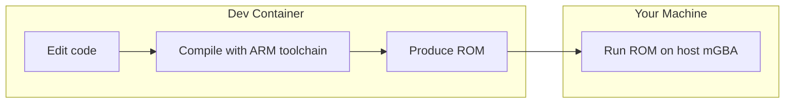
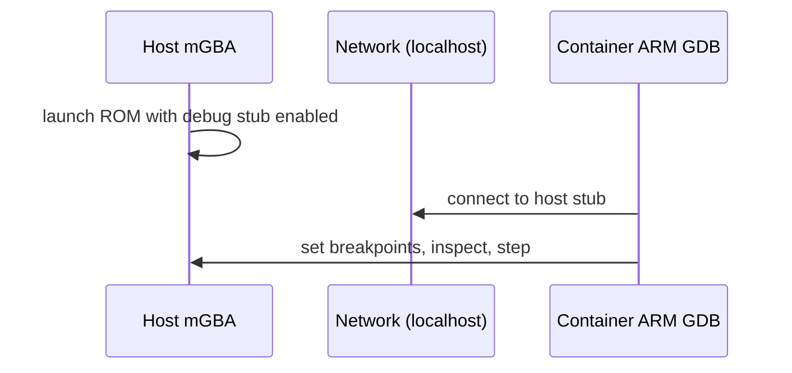
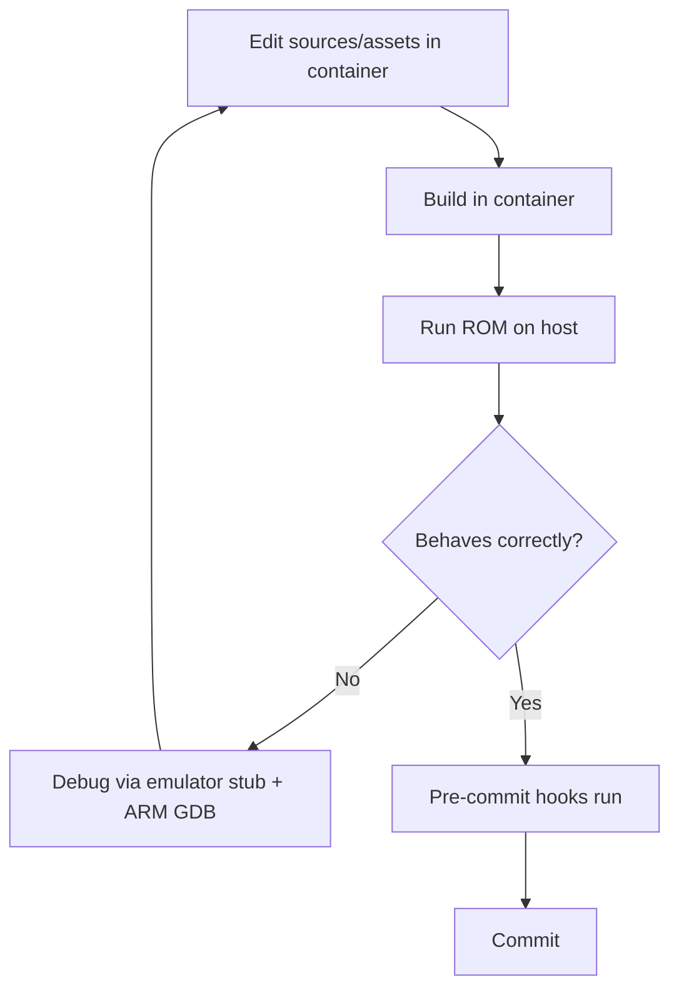

# Development Workflow

This page describes **how to work on the project day to day**: building,
testing, debugging, version control, and contributing. The exact shell commands
live in the repository `README.md`; this page explains the *why* behind each
step and the conventions to follow. For environment setup, see
[Getting Started](getting-started.md).

## The golden rule: build in the container, run on the host

The single most important workflow principle:



- **Build inside the container**, because that is where the ARM cross-compiler
  lives. Attempting to build on the host fails with "command not found."
- **Run on the host**, because mGBA with a graphical window is simplest there
  (no display-forwarding headaches).
- **Debug from the container** when you need the ARM debugger, connecting over
  the network to an emulator running on the host.

This split is deliberate and keeps each side doing what it is best at.

## Building process overview

Building is a single step from the developer's point of view, but it does several
things under the hood:

1. **Process assets.** Graphics and audio in the game folders are converted into
   the binary forms the handheld expects.
2. **Compile sources.** Game code, shared engine code, and the engine itself are
   cross-compiled for ARM.
3. **Link.** The pieces link into a ROM file (and a debug ELF).
4. **Report.** The output ROM appears at the repository root, named for the
   configured target.

There are several equivalent ways to trigger a build (a Make target, a wrapper
script, a direct container command, or the editor's "run build task" shortcut).
Pick whichever fits your flow; they all produce the same ROM.

> **First build is slow.** The very first build assembles the container image,
> which takes a few minutes. After that, incremental builds are fast.
>
> Creating the container also runs `post-create.sh` once (`postCreateCommand`):
> it installs the pre-commit hook and does one full build under `bear` to
> generate `compile_commands.json` for clang-tidy. That file lives in the
> workspace and is git-ignored, so rebuilding the container skips the build while
> it exists. After adding source files or changing the Makefile, regenerate it
> with `./post-create.sh --force`.

## Testing methodology

Testing splits into an automated layer (host-side unit tests + CI) covering
pure logic, and manual/behavioral testing covering everything that actually
needs the emulator - gameplay feel, timing, and rendering can't be unit
tested, so they stay manual on purpose.

### Automated: host-side unit tests (`tests/host/`)

A small, dependency-free test suite (`tests/host/test_framework.h` - no
GoogleTest/Catch2 to install or vendor) covers the handful of files with
**zero Butano/GBA dependency**: `save_integrity.h/.cpp` (CRC32, header/
checksum validation - including a known external CRC-32 test vector, not
just internal self-consistency), `save_buffer.h` (`SaveBuffer` read/write
round-trips), `game_state.h` (`set_no_death_clear()`/`has_no_death_clear()`
bit-flag helpers), and `frame_time.h` (`frames_to_time()`, including the
>99-minute case `SummaryScene`'s total-time readout can hit).

These build with the **host's own g++/clang++**, not the ARM cross-compiler
- no devkitARM, no Butano, no container needed:

```bash
make test                          # host tests + tools/ tests + level data checks
make -C tests/host                 # builds and runs; non-zero exit on any failure
make -C tests/host FILTER=crumble  # only tests whose name contains "crumble"
make coverage                      # line coverage of game/ per file
```

Every test file compiles to its own object in `build/host-tests/` with header
dependencies, so after a change only the affected files rebuild (about 1-2
seconds - fast enough for a test-first red/green loop). A failing `CHECK_EQ`
prints both values; a filter that matches no test fails, so a typo cannot pass.

The same extraction pattern covers the later features: the pure decision
logic of Assist/Hard Mode (`game_modes.h`: `modes::trap_speed_mode()`,
mutually exclusive toggles, Options row indices), the dash (`dash_controller.h`
`DashController`: start/duration/cooldown/air-charge/cancel rules, plus the
`Cfg::Dash` invariants in `cfg_dash.h`), list-menu cursor wrapping
(`menu_nav.h`), the dash afterimage pool (`dash_trail.h`: spawn cadence, slots,
lifetime, flicker), save migration (`save_migration.h` / `game_state_migration.h`:
prefix copy, defaults for new fields, padding safety, a `GameState` layout lock), the checkpoint rules (`checkpoint_logic.h`: furthest flag wins, trigger snapshot masks, `TriggerState::restore()`), trigger modes (`trigger_logic.h`: latch/toggle/hold,
including a check that Latch matches the original behavior) and the
switched-platform rules (`switch_logic.h`), the one-time level hint rules (`hint_logic.h`: when it
shows, how long it stays), and the controls overview text (`controls_text.h`: line
count, length, ASCII and sprite-budget limits, and that the dash line names
the world `Cfg::Dash::UNLOCK_WORLD` unlocks) and the entity-limit rule
(`level_limits.h`: a level with exactly `Cfg::Level::Limits` entries fits, one
more does not) and the camera rig (`camera_rig.h`: smoothing never overshoots,
look-ahead direction, look up / down hold, world-edge bounds, also with
truncating fixed-point numbers) and the death feedback (`death_fx.h`: freeze
length, the end of the freeze reported once, shake fading out, flicker
pattern), the trap frame scaling (`trap_timing.h`) and the one-frame player
events with the jump / dash trigger rule (`player_events.h`,
`trigger_logic.h`) and the crumbling-platform state machine
(`crumble_logic.h`). `PlayerLocomotion`,
`LevelManager`, `PauseController` and the scenes only feed these helpers
and apply their results, so what is left in the Butano-dependent files is
glue that still needs the manual checks below.

`frame_time.h` is `FrameTime`/`frames_to_time()` extracted out of `timer.h`
specifically so it has no Butano include chain to drag along - `timer.h`
includes it, so every existing `#include "timer.h"` call site is
unaffected.

When adding a new pure-logic helper (no `bn::` types, no hardware access),
consider whether it belongs in a similarly dependency-free header so it can
gain the same kind of test coverage, rather than being bundled into a
Butano-dependent file where it becomes untestable on the host.

### Automated: CI (`.github/workflows/ci.yml`)

Two independent jobs, so the fast check isn't blocked by the slow one:

- **`host-tests`** - checks out just the `extern/engine` submodule (not its
  nested Butano submodule, which host tests never touch), runs
  `make -C tests/host` and prints the line coverage (`make coverage`). No
  Docker, no ARM toolchain - this is the fast, cheap check.
- **`gba-build`** - checks out recursively, builds the dev container image
  from `docker/Dockerfile` (the same image the devcontainer uses), runs
  `make` inside it to produce the ROM, then runs `./test-rom.sh` headlessly
  inside the same container - confirms the ROM actually boots. Marked
  `continue-on-error: true` for now (see the comment in `ci.yml` for why);
  it still runs and reports its real status, just doesn't block the rest
  of the workflow.

A separate workflow, `.github/workflows/python-tools.yml`, runs the Python
side on its own: every `tools/test_*.py` (the checkers, the reachability
simulator, the sprite and sound generators) and the level-data checks via
`make checks` (`Check_trigger_references.py`, `Check_level_hints.py`,
`Check_world_index.py`, `Check_checkpoints.py`, `Check_sprite_budget.py`,
`Check_hitboxes.py`, `Check_level_reachability.py --all`).
It needs no Docker or ARM toolchain and only the first-level `extern/engine`
submodule (not its nested Butano), so it is fast and independent of the slower
`gba-build` job.

The image `gba-build` builds depends only on `docker/Dockerfile` (repo
source is bind-mounted at `docker run` time, never baked into the image),
so it's cached as one unit keyed by that file's hash via `actions/cache` -
`docker save`/`docker load` around the build step. A run where the
Dockerfile hasn't changed skips the devkitPro/mGBA/LLVM install entirely
and just restores the saved image.

### Level data checks (`tools/Check_trigger_references.py`)

Statically validates every `TrapData::trigger_name` a `MOVING`/`PATH` trap
references against the `TriggerData::name` entries actually defined for
that same level - the same per-level lookup
`LevelManager::get_trigger_by_name()` performs at runtime, checked here
without compiling or running the game. Also warns (non-fatal) about
triggers that are defined but never referenced by any trap in their level.

It also validates `PlatformData::trigger_name` (a platform bound to a switch)
the same way, and counts a platform reference as "used" so a trigger that only
drives platforms is not reported as unreferenced. The checker itself has unit
tests (`tools/test_check_trigger_references.py`), run with:

```bash
python3 -m unittest discover -s tools -p 'test_*.py'
```

Pure Python, no C++ involved:

```bash
python3 tools/Check_trigger_references.py
```

Runs both as a CI job and as a local pre-commit hook (triggered only when
level data or the script itself changes), so a dangling trigger reference
gets caught before it reaches a PR, not just at commit time in CI.

### Level geometry and roster checks

Static checkers keep level content honest (pure Python, no C++):

- `tools/Check_level_reachability.py FILE LEVEL...` - a jump/dash reachability
  check driven by a small re-implementation of the duck's per-frame movement.
  It reports the reachable platforms and door, with and without the dash, for a
  conservative and an optimistic start, over every lever configuration the duck
  can set. Use it when placing platforms: a gap meant to need the dash must
  fail the no-dash optimistic run (see [Level Design](level-design.md#dash-and-switch-levels)).
  Its tests calibrate the model against the documented jump/dash envelope and
  check the two World 5 levels' design intent. `--all` checks the whole
  roster in play order (the dash only from `Cfg::Dash::UNLOCK_WORLD` on) and
  fails if any door cannot be reached; it runs in CI and as a pre-commit hook
  and takes about 20 seconds.
- `tools/Check_hitboxes.py` - compares every platform and trap collision box
  with the opaque pixels of the sprite frame the game shows for it. On a
  platform the duck must stand on the picture (no sinking in or floating, no
  standing in the air beside it, no dropping off a visible edge); a trap must
  not kill before the pictures touch. Tolerance 3 px for platforms, 2 px for
  traps. To fix a height, move the picture (`x`/`y`) and keep the hitbox
  (`x + offset_x`, `y + offset_y`), so jumps stay the same; a width can only be
  fixed in the hitbox. Runs in CI and as a pre-commit hook.
- `tools/Check_world_index.py` - confirms `WorldIndex::WORLDS` still describes
  main.cpp's `levels[]` (no gaps or overlaps, same total, no duplicates; warns
  about levels defined but not listed). It also runs as a pre-commit hook.
- `tools/Check_level_hints.py` - validates `LevelData::intro_hint` strings:
  28 characters at most (the limit comes from `hint_logic.h`), printable ASCII
  only, never empty. Also a pre-commit hook.
- `tools/Check_checkpoints.py` - validates `LevelData::checkpoints`: the flag
  stands on a platform that is not switched, the respawn box overlaps no
  platform, trap start box or anywhere on a trap's path (the whole PATH route,
  the MOVING track, the CHASE row, the AMBUSH lunge), the platform is reachable
  from the spawn (jump + dash model), count within
  `Cfg::Level::Limits::CHECKPOINTS` (one per level), plus warnings for an ambush
  range, order and spacing. Runs in the Python CI job.
- `tools/Check_sprite_budget.py` - checks every level against the entity limits
  (`Cfg::Level::Limits`), the `SpriteRegistry` capacity and the 128 hardware
  sprites, in a worst-case model (see
  [System Internals](system-internals.md#sprite-and-entity-budgets)), and the
  `CollisionRegistry` capacities against the limits. Runs in the Python CI job
  and as a pre-commit hook. The engine headers it reads live in the
  `extern/engine` submodule (the Python CI job checks it out); where it is not
  checked out, e.g. in a plain clone, the script uses built-in defaults and
  prints a `NOTE`.

- `tools/Preview_level.py [FILE.h] [LEVEL ...]` - draws levels as SVG pictures
  (see [Level Design](level-design.md#previewing-levels)). The Python CI job
  renders every level and uploads the pictures as the `level-previews`
  artifact, so a layout change can be reviewed without building the ROM.

Run all Python tests with:

```bash
python3 -m unittest discover -s tools -p 'test_*.py'
```

Because `GameState::best_time_frames`, `no_death_clears`, `level` and
`furthest_level` are indexed by position in `levels[]`, inserting a level
shifts every later level's records. Insert as late as the design allows - the
two World 5 levels went in before the boss, so only the boss and the finale
moved - and mention the shift in the commit.

### Manual (still required - nothing above replaces this)

- **Manual play testing** in the emulator is the main loop. After a change,
  load the ROM and verify the affected behavior: Does the duck jump as intended?
  Does a new hazard trigger at the right moment? Does death/respawn still work?
- **Clearability testing for levels.** After editing a stage, walk the intended
  path and confirm every required jump is achievable within the physics envelope
  (climbs ≤ 16px, gaps ≤ 40px per the [Level Design](level-design.md) rules).
- **Headless / CI run.** The same `./test-rom.sh` helper script the
  `gba-build` CI job uses; useful to run locally too when you just need to
  confirm the ROM boots and runs a bit, without a graphical window.
- **Save-state / persistence checks.** Verify that deaths, the timer, level
  progression, and save slots survive a quit-and-reload.

A practical manual test checklist for any gameplay change:

| Area | What to verify |
|------|----------------|
| Movement | Acceleration, jump height, coyote/buffer feel, screen-edge bounce |
| Traps | Activation timing, hit behavior, reset on respawn |
| Triggers | Fire at the intended zone; linked traps respond correctly |
| Level hints | Show once at the start of World 3's first level, "Cloak Corridor" and "Lever Hall"; B or five seconds hides them; gone after the first clear; hidden while paused (also in the first frame of the pause) and back on resume with the countdown where it stood |
| Camera | Glides after the duck on scrolling levels instead of sticking to it; looks ahead in the direction of travel; no seam or jitter on platforms; cuts (does not glide) to the respawn point after a death; turning at a world edge is followed at once |
| Death feedback | Short freeze with a copy of the duck where it died and the killing trap still in place; screen shake that fades, HUD and background steady; duck flickers after respawn and is NOT invulnerable; no effect on Restart Level; pausing during the freeze and leaving the level during it leave nothing behind; the record time is not affected |
| World 5 dash / lever levels | Dash gaps clear with a dash; levers flip once per pass and show the right frame; the Room 2 stone disappears and returns |
| Switches | Toggle flips per entry, Hold releases on exit; bound platforms appear/vanish with their trigger; a platform never appears inside the duck; death resets switches and platforms |
| Progression | Door advances to the right stage; final stage triggers the kiss scene |
| Persistence | Deaths/timer/level saved and reloaded per slot |
| Pause | Menu navigates; continue/restart/title behave correctly; after resuming (also from inside Options or Controls with Start) the level shows no leftover menu text and the sprite count is back to normal (a mGBA sprite viewer shows the hidden ones) |
| Dash | Whoosh sound and a flickering afterimage trail while dashing, none left behind after a death or level end; B dashes from World 3 onward (not in Worlds 1-2); one air dash per jump, refilled on landing; wall/edge/death cancel it |
| Assist / Hard Mode | Toggling one turns the other off; traps and coyote/buffer change from the next level load |
| Controls overview | Reachable from the start screen's "Controls" entry and the pause menu; A/B returns; text fits on screen in the longest level |

## Debugging approach

Debugging combines the emulator's remote stub with the container's ARM
debugger:



The recommended pattern:

1. **Start the emulator on the host** with its debug stub enabled, so it listens
   for a debugger connection.
2. **Connect the ARM debugger from the container** to that stub (the container
   is the only place the ARM debugger exists; it reaches the host emulator over
   the container network).
3. **Set breakpoints and inspect** as you would in any native debugging session.

For faster iteration without full debugger setup, the editor's integrated build
and debug launchers wrap the right commands for the right environment
(container vs. host). Headless mode plus console logging is also available for
quick checks.

> **Why the split again?** The build toolchain and the ARM debugger only exist
> in the container; a comfortable emulator display only exists on the host. The
> network connection between them is the bridge.

### Debugging tips

- **Reproduce with the minimal ROM.** If something breaks, confirm it with a
  clean build before suspecting environment issues.
- **Watch for resource ceilings.** Sudden graphical glitches or sprite
  disappearance can mean a sprite-slot or palette budget was exceeded; check
  that stages release resources on unload.
- **Use headless runs** to catch crashes that don't need a display.

## Version control practices

The project uses Git with submodules for the engine and shared engine code.
Conventions:

- **Clone with submodules** (recursive clone). If submodules are missing after a
  clone or after pulling, update and initialize them.
- **Commit small, focused changes** with clear messages. The repository uses a
  mailmap, so commit authorship is normalized — respect existing attribution.
- **Keep generated output out of version control.** Build artifacts (the ROM,
  ELF, build directory) are ignored; commit sources and assets, not outputs.
- **Coordinate asset renames carefully,** since level data references assets by
  derived names — a rename must update every reference.

## Contribution guidelines

### Code style & automated checks

Consistent style is enforced before commits using pre-commit hooks backed by
`clang-format` (formatting) and `clang-tidy` (static analysis/lints). These run
automatically in the container. If you work outside the container, you need
pre-commit plus the same linters installed locally. Let the hooks reformat your
code rather than fighting them — the goal is uniform style across contributors.

### How to make a change well

1. **Read the relevant concept doc first** (this documentation set) so your
   change fits the architecture rather than fighting it.
2. **Make the smallest change that achieves the goal.** Favor composition and
   the existing patterns (data-driven levels, shared trap base, resettable
   interface) over new bespoke mechanisms.
3. **Keep the build green and tests manual-passing** — verify in the emulator
   before submitting.
4. **Update documentation** if you change a concept, add a subsystem, or alter
   a workflow. The docs are part of the contribution.
5. **Run the pre-commit hooks** so style/lint issues don't block the change.

### Design conventions to honor

- **Stay data-driven** for level content; don't hard-code stage specifics into
  gameplay logic.
- **Respect the physics envelope** when placing platforms.
- **Match themes** when adding art or hazards.
- **Preserve the forgiving-feel mechanics** (coyote time, jump buffering,
  variable jump height) unless there is a strong reason to change them.
- **Keep the personality** — the duck theme and light tone are part of the
  project's identity.

## Iteration loop (summary)



## Related
- [Index](index.md)
- [Getting Started](getting-started.md)
- [Project Architecture](architecture.md)
- [System Internals](system-internals.md)
- [Extensibility Guide](extensibility.md)
- [Glossary](glossary.md)