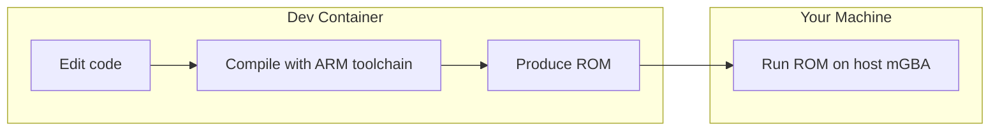
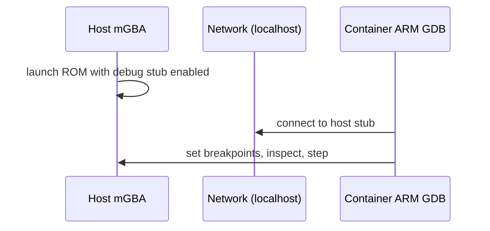
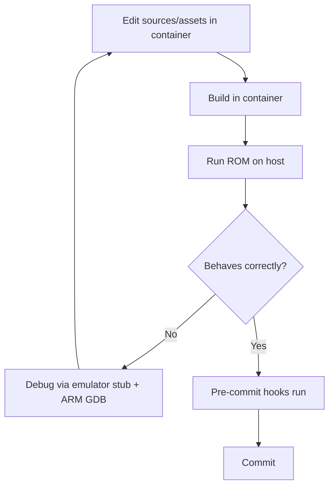

# Development Workflow

This page describes **how to work on the project day to day**: building,
testing, debugging, version control, and contributing. The exact shell commands
live in the repository `README.md`; this page explains the *why* behind each
step and the conventions to follow. For environment setup, see
[Getting Started](getting-started.md).

## The golden rule: build in the container, run on the host

The single most important workflow principle:



- **Build inside the container**, because that is where the ARM cross-compiler
  lives. Attempting to build on the host fails with "command not found."
- **Run on the host**, because mGBA with a graphical window is simplest there
  (no display-forwarding headaches).
- **Debug from the container** when you need the ARM debugger, connecting over
  the network to an emulator running on the host.

This split is deliberate and keeps each side doing what it is best at.

## Building process overview

Building is a single step from the developer's point of view, but it does several
things under the hood:

1. **Process assets.** Graphics and audio in the game folders are converted into
   the binary forms the handheld expects.
2. **Compile sources.** Game code, shared engine code, and the engine itself are
   cross-compiled for ARM.
3. **Link.** The pieces link into a ROM file (and a debug ELF).
4. **Report.** The output ROM appears at the repository root, named for the
   configured target.

There are several equivalent ways to trigger a build (a Make target, a wrapper
script, a direct container command, or the editor's "run build task" shortcut).
Pick whichever fits your flow; they all produce the same ROM.

> **First build is slow.** The very first build assembles the container image,
> which takes a few minutes. After that, incremental builds are fast.
>
> Creating the container also runs `post-create.sh` once (`postCreateCommand`):
> it installs the pre-commit hook and does one full build under `bear` to
> generate `compile_commands.json` for clang-tidy. That file lives in the
> workspace and is git-ignored, so rebuilding the container skips the build while
> it exists. After adding source files or changing the Makefile, regenerate it
> with `./post-create.sh --force`.

## Testing methodology

Testing has four layers. Gameplay feel, timing and rendering cannot be unit
tested, so they stay manual on purpose.

| Layer | Command | What it covers |
|-------|---------|----------------|
| Host unit tests | `make test` | pure game rules, the Python tools, the level data checks |
| Level data checks | `make checks` | levels, hitboxes, budgets, generated files (part of `make test`) |
| Replays | `make replay` | every level played to its door in the emulator |
| Photographed tour | `make tour` | what only shows on screen |

### Host unit tests (`tests/host/`)

The tests build with the **host's own g++/clang++**, not the ARM compiler: no
devkitARM and no container needed. The framework is a single header
(`test_framework.h`). The game's rules live in headers without Butano
dependency (`*_logic.h`, `locomotion.h`, `level_flow.h`, `pause_flow.h`,
`hint_logic.h`, ...), so the tests drive them directly; they may use Butano's
header-only types such as `bn::fixed`, so movement is tested with the game's
own fixed-point arithmetic (it rounds: `0.3 * 1` is 0.297). Each header names
its test file in its header comment; `ls tests/host` is the list.

```bash
make test                          # host tests + tools/ tests + level data checks
make -C tests/host                 # only the host tests; non-zero exit on any failure
make -C tests/host FILTER=crumble  # only tests whose name contains "crumble"
make coverage                      # line coverage of game/ per file
```

Every test file compiles to its own object in `build/host-tests/`, so after a
change only the affected files rebuild (about 1-2 seconds). A failing
`CHECK_EQ` prints both values; a filter that matches no test fails, so a typo
cannot pass.

When adding a rule (no hardware access, at most header-only `bn::` types),
write its test first and put the rule in such a header rather than in a
Butano-dependent file where it becomes untestable on the host. Hardware input
reaches a rule as a value (`InputState` in `locomotion.h`), collision queries
through a small interface the test can fake. `PlayerLocomotion`, `LevelManager`,
`PauseController` and the scenes only feed these helpers and apply their
results; that glue is covered by the replays and the manual checks below.

### Replays in the emulator (`make replay`)

The host tests check rules; whether a level can really be played to its door
with the real game, traps and all, is checked by **replays**: recorded buttons
of a finished attempt, one file per level in `game/replays/`. The commands,
the file format and the recording workflow are documented at the top of
`tools/replays.py`. In short:

- `make replay` builds the game with `PLATFORMER_REPLAY` (no title screen), plays
  every recording in mGBA without a frame limit and fails unless each reaches
  its door. Levels without a recording are listed. CI runs it in `gba-build`.
- `make record` builds a recording ROM; the last finished attempt of each
  level is stored in SRAM and imported with `tools/replays.py import`.
- **Counter-checks** (`game/replays/counter/`) must *not* finish their level:
  the duck walks into a door that has to stay shut, e.g. a boss door while the
  boss lives.
- Buttons are recorded per movement step, so the death freeze and pauses do
  not shift them. A change to movement, physics, traps or level data that
  breaks a recording fails the replay: re-record that level if the change is
  intended. A recording keeps the deaths it began with (`"deaths"`), so a
  level with death windows replays on the layout it was recorded on.

### Photographed tour (`make tour`)

`tools/tour.py` walks through the real game (menus, story pages, the pause
overlay, bosses, ending, summary) in mGBA and keeps a screenshot at each
step; see its docstring and `game/src/tour.cpp`. Results are in
`platformer.tour/shots/` with a `report.html` saying what to look for.
`python3 tools/tour.py compare OLD NEW` lists shots that changed between two
runs. It takes about 4 minutes and is a manual review aid, not a pass/fail
test.

### CI

- **`host-tests`** (`.github/workflows/ci.yml`): host unit tests plus line
  coverage. No Docker, no ARM toolchain.
- **`gba-build`** (`ci.yml`): builds the dev container image from
  `docker/Dockerfile` (cached by that file's hash), builds the ROM, runs
  `./test-rom.sh` and `make replay`. See the comment in `ci.yml` for why it is
  `continue-on-error`.
- **`python-tools.yml`**: every `tools/test_*.py` plus `make checks`, and
  renders the level previews as an artifact. Needs no Docker or ARM toolchain.

### Level data checks (`make checks`)

Pure Python, no C++. Each script's docstring says what it verifies and why;
the ones that matter when you edit a level:

- `Generate_levels.py --check` - `levels_world*.h` match `game/levels/*.json`
  (edit the JSON, never the header).
- `Check_trigger_references.py` - every `trigger_name` resolves to a trigger of
  the same level, as `LevelManager::get_trigger_by_name()` does at runtime.
- `Check_level_reachability.py FILE LEVEL...` / `--all` - a jump/dash
  reachability model of the duck's movement; a gap meant to need the dash must
  fail the no-dash run (see [Level Design](level-design.md#dash-and-switch-levels)).
- `Check_hitboxes.py` - every platform, trap, boss and checkpoint box against
  the opaque pixels of every animation frame of its sprite. To fix a height,
  move the picture (`x`/`y`) and keep the hitbox (`x + offset_x`,
  `y + offset_y`), so jumps stay the same; a width can only be fixed in the
  hitbox.
- `Check_checkpoints.py`, `Check_level_hints.py`, `Check_world_index.py`,
  `Check_sprite_budget.py` (see
  [System Internals](system-internals.md#sprite-and-entity-budgets)).
- `Make_boss_music.py --check` and `replays.py generate --check` - the
  generated boss music and `replay_data.h` are current.
- `Preview_level.py` draws levels as SVG (see
  [Level Design](level-design.md#previewing-levels)).

The relevant ones also run as pre-commit hooks (`.pre-commit-config.yaml`). Run
the Python tests alone with `python3 -m unittest discover -s tools -p 'test_*.py'`.

Because `GameState::best_time_frames`, `no_death_clears`, `level` and
`furthest_level` are indexed by position in `levels[]`, inserting a level
shifts every later level's records: bump the save version and add an
`insert_level()` line (see `game_state_migration.h`).

### Manual (still required - nothing above replaces this)

- **Manual play testing** in the emulator is the main loop. After a change,
  load the ROM and verify the affected behavior: Does the duck jump as intended?
  Does a new hazard trigger at the right moment? Does death/respawn still work?
- **Clearability testing for levels.** After editing a stage, walk the intended
  path and confirm every required jump is achievable within the physics envelope
  (climbs ≤ 16px, gaps ≤ 40px per the [Level Design](level-design.md) rules).
- **Headless / CI run.** The same `./test-rom.sh` helper script the
  `gba-build` CI job uses; useful to run locally too when you just need to
  confirm the ROM boots and runs a bit, without a graphical window.
- **Save-state / persistence checks.** Verify that deaths, the timer, level
  progression, and save slots survive a quit-and-reload.

A practical manual test checklist for any gameplay change:

| Area | What to verify |
|------|----------------|
| Movement | Acceleration, jump height, coyote/buffer feel, screen-edge bounce |
| Traps | Activation timing, hit behavior, reset on respawn |
| Triggers | Fire at the intended zone; linked traps respond correctly |
| Level hints | Show once at the start of World 3's first level, "Cloak Corridor" and "Lever Hall"; B or five seconds hides them; gone after the first clear; hidden while paused (also in the first frame of the pause) and back on resume with the countdown where it stood |
| Camera | Glides after the duck on scrolling levels instead of sticking to it; looks ahead in the direction of travel; no seam or jitter on platforms; cuts (does not glide) to the respawn point after a death; turning at a world edge is followed at once |
| Death feedback | Short freeze with a copy of the duck where it died and the killing trap still in place; screen shake that fades, HUD and background steady; duck flickers after respawn and is NOT invulnerable; no effect on Restart Level; pausing during the freeze and leaving the level during it leave nothing behind; the record time is not affected |
| World 5 dash / lever levels | Dash gaps clear with a dash; levers flip once per pass and show the right frame; the Room 2 stone disappears and returns |
| Switches | Toggle flips per entry, Hold releases on exit; bound platforms appear/vanish with their trigger; a platform never appears inside the duck; death resets switches and platforms |
| Progression | Door advances to the right stage; final stage triggers the kiss scene |
| Persistence | Deaths/timer/level saved and reloaded per slot |
| Pause | Menu navigates; continue/restart/title behave correctly; after resuming (also from inside Options or Controls with Start) the level shows no leftover menu text and the sprite count is back to normal (a mGBA sprite viewer shows the hidden ones) |
| Dash | Whoosh sound and a flickering afterimage trail while dashing, none left behind after a death or level end; B dashes from World 3 onward (not in Worlds 1-2); one air dash per jump, refilled on landing; wall/edge/death cancel it |
| Assist / Hard Mode | Toggling one turns the other off; traps and coyote/buffer change from the next level load |
| Controls overview | Reachable from the start screen's "Controls" entry and the pause menu; A/B returns; text fits on screen in the longest level |

## Debugging approach

Debugging combines the emulator's remote stub with the container's ARM
debugger:



The recommended pattern:

1. **Start the emulator on the host** with its debug stub enabled, so it listens
   for a debugger connection.
2. **Connect the ARM debugger from the container** to that stub (the container
   is the only place the ARM debugger exists; it reaches the host emulator over
   the container network).
3. **Set breakpoints and inspect** as you would in any native debugging session.

For faster iteration without full debugger setup, the editor's integrated build
and debug launchers wrap the right commands for the right environment
(container vs. host). Headless mode plus console logging is also available for
quick checks.

> **Why the split again?** The build toolchain and the ARM debugger only exist
> in the container; a comfortable emulator display only exists on the host. The
> network connection between them is the bridge.

### Debugging tips

- **Reproduce with the minimal ROM.** If something breaks, confirm it with a
  clean build before suspecting environment issues.
- **Watch for resource ceilings.** Sudden graphical glitches or sprite
  disappearance can mean a sprite-slot or palette budget was exceeded; check
  that stages release resources on unload.
- **Use headless runs** to catch crashes that don't need a display.

## Version control practices

The project uses Git with submodules for the engine and shared engine code.
Conventions:

- **Clone with submodules** (recursive clone). If submodules are missing after a
  clone or after pulling, update and initialize them.
- **Commit small, focused changes** with clear messages. The repository uses a
  mailmap, so commit authorship is normalized — respect existing attribution.
- **Keep generated output out of version control.** Build artifacts (the ROM,
  ELF, build directory) are ignored; commit sources and assets, not outputs.
- **Coordinate asset renames carefully,** since level data references assets by
  derived names — a rename must update every reference.

## Contribution guidelines

### Code style & automated checks

Consistent style is enforced before commits using pre-commit hooks backed by
`clang-format` (formatting) and `clang-tidy` (static analysis/lints). These run
automatically in the container. If you work outside the container, you need
pre-commit plus the same linters installed locally. Let the hooks reformat your
code rather than fighting them — the goal is uniform style across contributors.

clang-tidy runs through `tools/run_clang_tidy.py`, which works in a `git
worktree` without any setup: it derives a private compile database from the
main checkout's `compile_commands.json` (root path rewritten to the worktree)
and gives headers a C++ command, so they are never mistaken for C.

### How to make a change well

1. **Read the relevant concept doc first** (this documentation set) so your
   change fits the architecture rather than fighting it.
2. **Make the smallest change that achieves the goal.** Favor composition and
   the existing patterns (data-driven levels, shared trap base, resettable
   interface) over new bespoke mechanisms.
3. **Keep the build green and tests manual-passing** — verify in the emulator
   before submitting.
4. **Update documentation** if you change a concept, add a subsystem, or alter
   a workflow. The docs are part of the contribution.
5. **Run the pre-commit hooks** so style/lint issues don't block the change.

### Design conventions to honor

- **Stay data-driven** for level content; don't hard-code stage specifics into
  gameplay logic.
- **Respect the physics envelope** when placing platforms.
- **Match themes** when adding art or hazards.
- **Preserve the forgiving-feel mechanics** (coyote time, jump buffering,
  variable jump height) unless there is a strong reason to change them.
- **Keep the personality** — the duck theme and light tone are part of the
  project's identity.

## Iteration loop (summary)



## Related
- [Index](index.md)
- [Getting Started](getting-started.md)
- [Project Architecture](architecture.md)
- [System Internals](system-internals.md)
- [Extensibility Guide](extensibility.md)
- [Glossary](glossary.md)