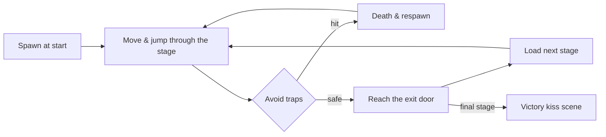

# Game Concepts

This page describes **what the game is like to play** and the ideas that shape
that experience. It is written for designers, new contributors, and anyone who
wants to understand the gameplay before touching the systems that implement it.
For how the systems work, see [Components](components.md); for how to build a
stage, see [Level Design](level-design.md).

## Core gameplay loop

The game is a classic side-scrolling platformer with a duck as the protagonist.
A single run through a stage follows this loop:

The loop is short and forgiving: dying sends the duck back to the spawn point,
the **death counter** increments, and the player retries immediately. The
**run timer** keeps counting so speedrun-style play is measurable, and a
level's personal-best clear time is recorded (and flashed on-screen) whenever
it's beaten - see [New Best banner](#new-best-banner) below.

## Player capabilities and controls

The duck can:

- **Walk** left and right with acceleration, ramping up to a top speed.
- **Jump** with variable height (hold the button longer to jump higher).
- **Fall** under gravity with a clamped maximum fall speed, so long drops are
  survivable and predictable.
- **Dash** (B, from World 3 onward) in a short horizontal burst - see
  [Dash](#dash).
- **Pogo** (R in the air, from World 4 onward) - strike down and bounce off
  a trap; see [Pogo](#pogo).
- **Wall slide and wall jump** (from World 5 onward) - see
  [Wall jump](#wall-jump).

The control scheme is intentionally simple:

| Input | Effect |
|-------|--------|
| D-Pad left / right | Move horizontally |
| A button | Jump (off a wall from World 5 onward) |
| B button | Dash (from World 3 onward) |
| R button | Pogo strike in the air (from World 4 onward) |
| Start button | Pause (opens the pause menu) |
| Select button | Show / hide the run timer |

The pause menu uses D-Pad up/down and A to navigate, mirroring the start-screen
controls for consistency.

### Level hints

A level can carry a short one-time hint (`LevelData::intro_hint`, at most 28
characters) that appears at the top of the screen when it starts: it teaches
the dash, and "Lever Hall" says levers flip when stepped on. It never blocks
play and goes away after five seconds or as soon as B is pressed. It is hidden
while the game is paused and the five seconds stand still meanwhile. It is shown
only while the level has not been cleared yet - no personal best and progress
has not moved past it - so it disappears for good with the first clear, also an
Assist Mode clear, and needs no extra save data.

### Controls overview

A short overview of all buttons is available without starting a level:

- **Start screen.** A "Controls" entry sits below the three save slots
  (reached with D-Pad down). A opens the overview, A/B/Start returns. It
  does not load or touch any save slot, and B on it does nothing.
- **Pause menu.** A "Controls" entry sits between Options and Title Screen.
  The list replaces the menu in place (no scene change, so the level stays
  loaded); A or B returns to the menu.

Both show the same text, so the two can never disagree.

### Feel-oriented mechanics

Several mechanics exist purely to make the duck *feel* responsive:

- **Acceleration & max speed.** Movement ramps up rather than snapping, which
  makes the duck feel weighty but still nimble.
- **Coyote time.** For a few frames after leaving a ledge, the duck can still
  jump, forgiving late inputs.
- **Jump buffering.** Pressing jump a few frames before landing still triggers a
  jump on contact, forgiving early inputs.
- **Variable jump height.** The longer the jump button is held, the higher the
  duck rises, enabling precise short hops and full leaps.
- **Fall speed clamp.** Prevents runaway fall speeds so the player can still
  steer while descending.
- **Ground braking.** How quickly the duck comes to a stop after releasing
  the D-Pad is its own tuning knob, separate from how quickly it speeds up.
  Every world uses the same, snappy default - except Forest's mossy floor
  (see below), which trades some of that precision for a distinct feel.

- **Calm camera.** On scrolling levels the camera ignores small steps (a dead
  zone around the duck), then moves exactly with it, looks ahead once the duck
  really runs in one direction and cuts
  (not glides) to the respawn point after a death. Holding up or down looks
  that way once a level is taller than the screen.

Together, these create a "tight but forgiving" feel that the [Level Design](level-design.md)
spacing rules then respect. Braking is the one exception a level can opt
out of on its own terms: it only changes how far the duck skids to a stop,
never how high or far a jump can reach, so it can vary by level without
risking a platform becoming unreachable.

### Dash

The duck's one learned ability, in the spirit of Hollow Knight's cloak dash:

- **Burst.** B launches a fixed-length horizontal dash in the held
  direction (or the facing direction if none is held). Gravity is suspended
  for its duration - 8 frames at 4px/frame, a flat 32px - then normal
  movement resumes at walking speed.
- **Limits.** A 20-frame cooldown follows every dash. In the air it can be
  used once per air time and is refilled on landing (not by coyote time). On
  the ground only the cooldown limits it.
- **Cancels.** A wall ends the dash early; pressing A while on the ground
  turns it into a jump; dying cancels it.
- **No invincibility.** Traps still kill the duck during a dash. It is a
  movement tool, not a shield - timing a dash through a hazard window is the
  skill, not a free pass.
- **Availability.** Enabled from World 3 onward (`Cfg::Dash::UNLOCK_WORLD`),
  checked against the level being loaded. Worlds 1-2 were authored without
  it and play as before, also when replayed via Level Select.
- **Reach.** Dash adds horizontal reach only: jump height is unchanged
  (~22px climb), horizontal reach grows from ~54px (jump) to roughly 100px
  (jump + dash). Every existing layout stays clearable without it.
- **Feedback.** A short whoosh sound and a flickering afterimage trail of
  ghosts left behind the duck - no extra graphics, the trail reuses the duck's
  own sprite.
- **Hint.** The first dash-enabled level (World 3's "LEVEL_3") shows "New:
  Dash with B" once, and the first level that cannot be finished without the
  dash ("Cloak Corridor") shows "Too far? Jump + B to dash". See
  [Level hints](#level-hints).
- **Required in World 5.** "Cloak Corridor" has three gaps (84-92px) that
  only the dash crosses, and "Lever Hall" offers a dash shortcut in two of
  its rooms - see [Dash and switch levels](level-design.md#dash-and-switch-levels).

### Pogo

Hollow Knight's down slash, turned to the game's rule that the environment is
the enemy: traps cannot be destroyed, but they can be used. Tuned in
`Cfg::Pogo` (`cfg_pogo.h`), rules in `locomotion::Core`, tests in
`tests/host/test_locomotion.cpp`:

- **Strike.** R in the air strikes down for 10 frames: a 16 px wide box
  reaching 12 px below the duck (more than one frame of falling, so the strike
  meets a trap before the body does). A slash is drawn there (placeholder
  art, `pogo16x16.bmp`) and a short swish plays.
- **Bounce.** A trap in the box bounces the duck up at jump speed (not cut by
  letting go of A), rings (`trap_hit`), refills the air dash and allows the
  next strike at once - spike, spike, spike. The trap is unharmed. A bounce
  counts as a jump for jump triggers.
- **Miss.** A strike that meets nothing is followed by 8 frames without one.
- **Death stays instant.** Touching a trap any other way still kills.
- **Availability.** From World 4 onward (`Cfg::Pogo::UNLOCK_WORLD`), like the
  dash, and in every boss level. World 4 opens with "Bramble Hop", which
  teaches it: two pits wider than jump + dash, crossed only by bouncing off
  thorn bushes - once, then twice in a row.
- **Reachability.** `tools/Check_level_reachability.py` lets the duck bounce
  off a level's BASE traps (they never move), only where a level cannot be
  finished without it.

### Wall jump

Hollow Knight's Mantis Claw, tuned in `Cfg::WallJump` (`cfg_wall_jump.h`),
rules in `locomotion::Core`, tests in `tests/host/test_locomotion.cpp`:

- **Slide.** Falling while holding toward a wall the duck touches caps the
  fall speed at 1 px/frame. Rising is never slowed. The duck turns its back
  to the wall and dust drifts up along it (`ente.bmp` frames 10-11).
- **Jump.** A in the air at a wall jumps at full jump speed and pushes the
  duck 2 px/frame away from the wall. For 8 frames (or until it lands) the D-pad is ignored, so
  the duck really leaves the wall. The jump buffer works as on the ground; on
  the ground a normal jump always wins.
- **No refill.** A wall does not refill the air dash, only real ground does.
- **Availability.** From World 5 onward (`Cfg::WallJump::UNLOCK_WORLD`),
  like the dash. Earlier worlds play as authored. Walls are platform sides
  only (the collision layer the duck stands on), never traps or the world
  edge.
- **Reachability.** `tools/Check_level_reachability.py` simulates wall jumps
  frame by frame (`Duck`) with a few climb policies: up a shaft between two
  walls and up a single wall.

## Story

Hildegard, the duck, is flushed out of the bathtub and travels through the
worlds to reach her beloved Susanne, who waits at the end of World 5's
finale. The story is told in short pages (`story.h`, shown by
`StoryScene`): the intro when a new game starts, one page the first time
the duck reaches each later world (not again when the world is replayed,
not via Level Select), and the ending after the finale, before the reunion
scene. A or Start goes on. A world that unlocks an ability (dash, pogo,
wall jump) teaches it on its page. Each page has at most 5 lines of 28
characters; `tests/host/test_story.cpp` checks that, which page shows when,
and that the ability pages follow the `Cfg` unlock worlds.

## Game progression

### World sequence

The game is structured as a sequence of **stages** grouped by theme. The
player moves from one stage to the next by reaching the **door** at the end of
each stage. After the final stage, the game switches to a celebratory **kiss
scene**.

The current world themes, in order, are:

| Theme | Mood | Visual palette |
|-------|------|----------------|
| Bathtub (World 1, 4 levels incl. boss) | Calm introduction | Blue bubbles, platforms |
| Sewerage (World 2, 3 levels incl. boss) | Industrial hazards | Pipes, cans, rusty nails |
| Forest (World 3, 3 levels incl. boss) | Misty climb | Trees, fog, mushrooms, slither arms |
| Village (World 4, 3 levels incl. boss) | Bright open spaces | Flowers, baskets, bugs, nests, an ambush bug |
| Dungeon (World 5, 6 levels incl. boss and finale) | Final gauntlet | Barrels, bars, chests, levers, an ambush mimic, axes, thwomps |

Each theme pairs a tilemap background, a music track, a set of themed trap
sprites, and a platform tileset. This pairing is what gives each world its
distinct identity. Forest also carries the theme into ground feel: its two
non-boss levels have a noticeably slippery, mossy floor - the duck skids
roughly twice as far before stopping there as it does everywhere else. The
boss arena deliberately keeps normal footing, so the dodge-heavy fight
doesn't also fight the floor.

### Save slots

The player can choose among three **save slots** on the start screen. Each
slot tracks the current stage, total deaths, the run timer, the chosen
music/SFX volume, the Hard Mode unlock/toggle state, a personal-best clear
time per level, and a no-death-clear badge per level.

Per-level best times and no-death badges are treated as durable records
rather than "current run" progress: finishing the entire game resets
level/deaths/timer to start a fresh run, but best times, no-death badges, and
the Hard Mode unlock all survive that reset (the Hard Mode *toggle* itself
does not - see [Hard Mode](#hard-mode) below).

Before picking a slot, each one already shows a hint of what's on it: "New"
for a slot that's never been played, or the furthest world reached
otherwise. It's a quick glance, not a full readout - see
[World-select stats](#world-select-stats) below for the fuller picture once
a slot is loaded.

### Pause & recovery

During gameplay, opening the pause menu offers:

- **Continue** — resume the current stage.
- **Restart Level** — reset the current stage's traps and respawn the duck at the stage's spawn point (a reached checkpoint is cleared).
- **Options** — adjust music and SFX volume (0-4), without leaving the
  paused overlay. Persisted per save slot. Once Hard Mode has been unlocked
  (see below), a third row lets the player toggle it on/off from here too.
- **Controls** — show the controls overview (A/B returns).
- **Title Screen** — leave to the title (progress is saved).

### Hard Mode

Hard Mode is an unlockable, per-save-slot difficulty toggle aimed at replay
value once a save has already finished the game once:

- **Unlock condition.** Completing the game (reaching the final door of
  World 5's finale) permanently unlocks Hard Mode for that save slot. The
  unlock is a one-way achievement flag - it is never re-locked, including
  by starting a fresh run on the same slot.
- **Toggling it.** Once unlocked, a "Hard Mode" row appears at the bottom of
  the pause menu's Options sub-menu, alongside Music and SFX. Left/Right (or
  either direction on the row) flips it On/Off; the change commits the same
  way Music/SFX do - once, on leaving the sub-menu, not on every keypress.
  While it's on, a short "Traps x1.35" line underneath shows the actual
  speed multiplier - informational only, not a selectable row.
- **Effect.** While enabled, Moving, Chase, and Ambush traps move faster
  (their velocities are scaled up). Path traps patrol faster too: their speed
  is authored as a frame count between waypoints, so the count is divided by
  the multiplier instead (15 frames per node become 11 at x1.35).
- **Persistence.** The On/Off toggle itself resets to Off on a fresh
  run/reset, the same way the audio volume settings do - only the *unlock*
  is a permanent record.

Hard Mode reuses the exact same level layouts, traps, and triggers; nothing
about a stage's data changes. It exists purely as a value multiplier applied
at trap-construction time, so it costs no extra level content or entity
budget - see [Components — Trap System](components.md).

### Assist Mode

Assist Mode is the mirror image of Hard Mode, for players who want to see
the levels without a high skill bar:

- **Availability.** Always available - no unlock. It is the last row of
  the pause menu's Options sub-menu (below Hard Mode once that is unlocked).
- **Effect.** Moving, Chase, and Ambush traps move at half speed (x0.5),
  and Path traps patrol at half speed as well (twice the frames per node).
  Coyote time grows from 4 to 8 frames and the jump buffer from 6 to 12. Jump height, gravity, and
  acceleration are untouched, so every platform stays reachable exactly as
  authored.
- **Exclusive with Hard Mode.** Switching one on switches the other off.
- **No records.** Best times and no-death clears are not recorded while it is
  on - it is a comfort option, not a leaderboard run - and no "New Best!"
  banner appears. Levels still count as cleared for progress and unlocks.
- **Persistence.** The toggle is saved per slot but resets to Off on a
  fresh run, like Hard Mode's toggle and the audio settings.
- **When it applies.** Like Hard Mode, trap speeds are applied when a
  level loads, so a change takes effect from the next level load.

## Level structure (player-facing view)

From the player's seat, every stage has the same skeleton:

1. A **spawn point** where the duck appears.
2. A series of **platforms** forming a path.
3. A set of **traps** and **trigger zones** that activate hazards.
4. A single **door** marking the exit.

Stages are sized either to one screen or to a wider scrolling world. Scrolling
stages use a camera that follows the duck within the world bounds, while
single-screen stages effectively pin the camera.

## Trap types & behaviors

From a player's perspective, traps come in a few recognizable kinds:

- **Static hazards** sit in gaps or on ledges and are always dangerous. They
  include things like rusty bars, nests, bushes, and disguised mimics.
- **Triggered hazards** are dormant until the duck steps into an invisible
  **trigger zone**, at which point they begin moving — falling bricks, rising
  arms, charging cans.
- **Patrol hazards** follow a fixed route, sweeping an area on a path (e.g. a
  branch sweeping back and forth, a bubble tracing a figure-8).
- **Chasing hazards** trail behind the duck and close the gap only when the
  duck advances. Standing still or retreating does not make them retreat, so
  they punish hesitation. This pressure mechanic appears in the final world.
- **Ambush hazards** look like harmless scenery (or a genuine decoration,
  like a chest among other chests) until the duck gets close, then lunge
  once and retreat. They punish approaching without care rather than
  punishing hesitation.
- **Cycling hazards** rise and sink on their own clock - spikes out of the
  floor that come, stay, go and wait, again and again. The duck learns the
  rhythm and crosses in the gap; neighbouring spikes can run a step apart so
  they form a wave. They can start on their own after a few seconds (a timer
  trigger) or be switched off by a lever.

Moving, Chase, Ambush, Path, and Cycle hazards all move faster when Hard Mode is
enabled (and slower in Assist Mode) - see [Hard Mode](#hard-mode) above.

For the internal behavior of each, see [Components — Trap System](components.md).

## Trigger zones

**Triggers** are invisible rectangular zones. They have no visual presence;
they only react to the duck entering them. A trigger can:

- Start in the **off** state (the common case) and switch to **on** once the
  duck crosses into it.
- Start **already on**, so a hazard is moving from the moment the stage loads.

Triggers let a single stage have multiple "moments": a falling brick released
mid-jump, a hazard that rises as the duck climbs, a flying pest released later
in the run. Without triggers, every moving hazard would be permanently active,
which would be hard to design around and visually chaotic.

### Fakes

Not every door is a door. A **fake door** or **fake checkpoint** looks exactly
like the real one - same sprite, same animation, standing behind the duck - and
kills on touch like any static hazard. They exist for the levels that want to
be mean on purpose; the real checkpoint's flag turns green when it is reached,
which is the one thing a fake never does.

The real door can lie as well. A **false exit** is the level's own door,
turned into a trap while some trigger is on - step on the wrong lever, wait
too long, walk instead of jump - and then it kills like a fake, without
looking any different. And a door can **move between attempts**: after a
few deaths in the level it stands somewhere else, so the route learnt by
dying leads to the wrong place (or, in a kind level, to a nearer one).
Death puts the trigger back, so every attempt starts with an honest door;
only the death count decides where it stands.

### Crumbling platforms

Some platforms do not wait for a trigger: they react to the duck itself. A
crumbling platform shakes when the duck lands on it and gives way a moment
later - the duck must keep moving, and stepping off does not save it. Some come
back after a while, some are single-use stepping stones. Death puts them all
back.

### Levels that learn

Death usually puts a level back exactly as it was - which is what makes it
learnable. A Level Devil level can break that promise on purpose: a trap or a
platform can be there only for the first few attempts, or only from a certain
death on. "After the 3rd death the trap sits somewhere else": the player who
has finally learned where the arms lurk finds them one gap further on. The
change only ever happens when the duck respawns, never in the middle of an
attempt, and the count starts again whenever the level is entered anew, so the
first attempt of every visit is the level as authored. Trickwood in World 3
is the first level that does it. See
[Level Design — Traps and platforms that change with every death](level-design.md#traps-and-platforms-that-change-with-every-death).

### Switches

Beyond the invisible latching zones, a trigger can behave as a **switch**
(every entry flips it) or a **pressure plate** (on only while the duck stands
on it), and can show a small sprite so it is recognizable. Switches drive the
same hazards as before and can also open and close platforms: one switch can
make a platform appear while another disappears, which allows puzzle-like
stages in the spirit of Level Devil - where the "obvious" switch is not
always the helpful one - without any new trap type. Death resets every
switch, so a puzzle always starts from the same state, and a platform that
would appear on top of the duck waits until the duck has moved clear.

A trigger can also act **late**: with a delay the hazard it releases only
starts a moment after the duck stepped on the zone or flipped the lever, and a
**timer** trigger needs no duck at all - it starts its hazards on its own a few
seconds after the level begins. Both keep a death cheap, because a respawn
restarts the clock.

Triggers can also be **chained**: one trigger sets off the next a moment later,
which can set off a third - the duck steps on a plate, the floor drops at once,
and a breath later spikes shoot out exactly where it would have landed. A chain
plays the same way every time, whatever the duck does in between, so the
player can learn it: the first time it is a Level Devil surprise, the second
time a rhythm to wait out. A death resets the whole chain; a checkpoint keeps
what had already happened before it was reached. Lever Hall in World 5 hides
one behind its first lever.

## Boss levels

Every world's gameplay culminates in a **boss level**: a mostly flat corridor
where the challenge is reading and dodging a sequence of attacks, the way a
Hollow Knight boss arena plays, and at its end the one enemy the duck can
beat - a **boss** (see [Bosses](#bosses)).

- **Attack waves.** Invisible trigger zones fire hazards in sequence as
  the duck advances - falling slams, charging dashes, or rising arms,
  depending on the world's theme.
- **A constant patrol.** One hazard (usually a sweeping `PATH` trap) is
  active for the whole fight, so the arena never feels static between
  triggered attacks. World 3's non-boss scroll level raises this to two
  patrols sweeping the identical route exactly out of phase with each
  other - a taste of "more than one thing to track at once" before the
  boss layers in everything else.
- **Punish lingering, not hesitating.** A mid-arena `AMBUSH` hazard,
  disguised as scenery, lunges only if the duck stays close - it rewards
  pressing on rather than camping a safe spot.
- **An enrage pursuer (Worlds 4-5).** A `CHASE` hazard trails the duck
  through the corridor, closing the gap whenever the duck advances. It keeps
  forward momentum mandatory in the two hardest boss levels and stops before
  the boss arena (`chase_limit`). World 4's
  second scroll level gives it a gentler non-boss preview - paired with an
  `AMBUSH` bug there, so pursuit pressure and dodge timing aren't both new
  at once when the boss tightens both.
- **The door is the win condition** - but it stays shut until the boss is
  beaten.

### Bosses

The game's rule is that nothing can be killed: the environment is the enemy.
The one exception is a boss at the end of each boss level - four mini bosses
(Worlds 1-4: the Kugelfisch King, the Rusty Can, the Toadstool, the Beetle)
and a big one in World 5 (the Iron Thwomp). `TrapType::BOSS`,
`boss_logic.h`, `BossTrap`:

- **The arena.** A step up to a left ledge (with the level's checkpoint), a
  pit, a right ledge with the door. The boss floats back and forth in the
  pit; falling in is death, touching the boss is death.
- **Pogo only.** A pogo strike from above costs it a hit (3 for the mini
  bosses, 5 for the big one) and bounces the duck - across the pit, too.
  The pogo is always available in a boss level, even before World 4.
- **Phases.** Every hit starts a new phase: the boss gets faster
  (`boss::phase_frames()`) and switches on the trigger `arena_p<n>`, which
  drops the world's traps through the pit - across the bounces, while the
  ledges stay safe. After a hit it blinks and takes no further hit for 45
  frames.
- **Feel.** A hit freezes the world for 4 frames and shakes the picture for
  10 (`Cfg::Boss::HITSTOP_FRAMES` / `SHAKE_FRAMES`, the death's freeze and
  shake, shorter).
- **Victory.** The last hit removes it, raises a stepping stone in the pit
  (`arena_won`) and opens the door. A death starts the fight over.
- **Tested.** An emulator replay per boss starts on the arena ledge and wins
  the fight (`make replay`); without its R presses each one fails.

### World 5's coda: the finale

World 5 adds one more level after its boss - a deliberate tonal reset. No
traps, no triggers, just a single unbroken walkway leading to Susanne. It
exists purely to let the tension of the boss fight settle before the game's
ending, the way a quiet epilogue follows a climax. Mechanically it's still
"reach the door" - Susanne stands in for the door itself, so the same
completion path applies, just without anything to dodge on the way there.
Reaching her is also what unlocks Hard Mode for the save slot - see
[Hard Mode](#hard-mode) above.

## Audio & visual identity

### Music

Each world has its own music track, selected at level-load time and played for
the duration of the stage. Menu, start, and end screens use their own cues.
Sound effects (jump, footsteps, trap hits, deaths) play on top of music.

### Tilemap backgrounds

Each world's backdrop is a tilemap background asset. Backgrounds are large
enough to support the world's scroll range, so a wider stage uses a wider
background and the camera pans across it.

### Animated sprites

The duck, the door, mimics, and several traps use frame-based animation. The
door has its own animation; mimics cycle frames to look "alive"; the duck's
animation depends on its current movement state.

## HUD (what the player sees)

A small **head-up display** shows:

- The **death counter** (incremented each respawn).
- The **run timer** (minutes : seconds : centiseconds).

Both are owned by the player's HUD component and toggle visibility when the
game is in a non-gameplay scene (e.g. title or kiss).

## Progress feedback

Beyond the per-frame HUD, a few moments call out progress explicitly:

### New Best banner

Finishing a level in less time than its previously stored personal-best
freezes the level-clear moment on a "New Best!" banner, showing the new
best-time (mm:ss.cc) and a "Press A to continue" prompt. The game only
advances to the next stage (or to the kiss scene, on the final level) once
the player acknowledges it with A or Start - the level clear itself is not
delayed, only the transition that follows it.

### No-death clears

If a level is cleared during an attempt in which the duck never died even
once, that level earns a permanent **no-death clear** badge for the save
slot. Level Select marks it with a trailing `*` next to that level's
best-time readout, so a fully clean clear is visually distinct from an
ordinary one. Like best times, this badge survives a full-game reset.

### World-select stats

Pressing B on the start screen (see below) leads to World Select, which also
shows a one-line summary for the loaded save slot: total deaths accumulated
on that slot, and how many levels have a recorded best time out of the total
level count. It's a quick "how am I doing on this save" readout, computed
from data that's already being tracked - no separate counter is needed.

### Run-complete summary

After the kiss scene, before the save slot resets for a fresh run, a short
summary screen shows what the finished playthrough added up to: total time
across every level's personal best, total deaths for the run, and how many
levels were cleared without a single death. Like the World-select stats
line, none of it is tracked specially for this screen - it's the same
per-level best times and no-death badges every level clear already records,
just totaled up once at the moment they're most worth seeing. The player
acknowledges it with A or Start before the slot resets and the game returns
to the title screen.

## Death, respawn, and difficulty

Death is cheap: the duck respawns at the stage's spawn point with no lives
system, and the death counter is the only penalty. This encourages experimentation
and fast retries, which suits short stages. The difficulty therefore comes from
trap timing and platform layout (and, once unlocked, Hard Mode's speed
multiplier), not from limited attempts.

A death is felt rather than just counted: the world freezes for a tenth of a
second with a copy of the duck frozen where it died and the trap that got it
still in place, the screen shakes, and the duck flickers for a moment when it
reappears at the respawn point. The flicker is only a visual cue - there is no
invulnerability. Restart Level from the pause menu skips the effect.

### Checkpoints

Some long levels and bosses have a **checkpoint**: a small flag, at most one per
level. Touching it (the grey flag turns green and raises) makes the duck
respawn there instead of at the start of the stage - until the level is
restarted from the pause menu or left. The flag never stands in a trap or on its
path. The death counter still counts every death, so a no-death
clear and the best time are unaffected. Which triggers had fired when the flag
was reached fire again after the respawn, so a boss fight keeps its patrols
instead of going quiet behind the flag. See
[Level Design — Checkpoints](level-design.md#checkpoints).

## Thematic personality

The game embraces a lighthearted identity: the duck, the kiss scene at the
end, whimsical trap names, and playful sound cues. This personality is part of
the design intent and should be preserved when extending the game — new content
that clashes with it should be reconsidered or thematically adapted.

## Design philosophy summary

- **Forgiving controls, demanding layouts.** The duck handles well; the stages
  are where the challenge lives.
- **Short, readable stages.** Each stage is small enough to memorize in a few
  attempts.
- **Visible hazards, invisible triggers.** Players should always be able to see
  what might hurt them; triggers stay invisible but their effects should be
  legible.
- **Thematic coherence.** Every element in a world should feel like it belongs
  to that world's theme.
- **Replay without new content.** Hard Mode raises the ceiling for players who
  already finished the game using the existing level roster, rather than
  demanding new stages for every difficulty step.

## Related
- [Index](index.md)
- [Level Design](level-design.md)
- [Components](components.md)
- [Asset Management](asset-management.md)
- [Glossary](glossary.md)