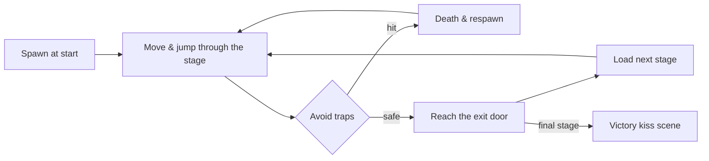

# Game Concepts

This page describes **what the game is like to play** and the ideas that shape
that experience. It is written for designers, new contributors, and anyone who
wants to understand the gameplay before touching the systems that implement it.
For how the systems work, see [Components](components.md); for how to build a
stage, see [Level Design](level-design.md).

## Core gameplay loop

The game is a side-scrolling platformer with a duck (Hildegard) as the
protagonist. A run through a stage follows this loop:

Dying sends the duck back to the spawn point (or the checkpoint), the **death
counter** increments, and the player retries immediately. The **run timer**
keeps counting, and a level's personal-best clear time is recorded whenever it
is beaten - see [New Best banner](#new-best-banner).

## Player capabilities and controls

The duck can walk with acceleration up to a top speed, jump with variable
height, and fall under gravity with a clamped fall speed. Three learned
abilities unlock by world: [dash](#dash) (World 3), [pogo](#pogo) (World 4)
and [wall jump](#wall-jump) (World 5).

| Input | Effect |
|-------|--------|
| D-Pad left / right | Move horizontally |
| A button | Jump (off a wall from World 5 onward) |
| B button | Dash (from World 3 onward) |
| R button | Pogo strike in the air (from World 4 onward) |
| Start button | Pause (opens the pause menu) |
| Select button | Show / hide the run timer |

The pause menu uses D-Pad up/down and A to navigate, like the start screen.

### Level hints

A level can carry a short one-time hint (`LevelData::intro_hint`, at most 28
characters) shown at the top of the screen when it starts, e.g. "New: Dash with
B" or "Step on a lever to flip it". It never blocks play and goes away after
five seconds or as soon as B is pressed. It is hidden while the game is paused
(the five seconds stand still meanwhile). In a boss level the countdown starts
only once the duck reaches the arena. A hint is shown only while the level has
not been cleared - no personal best and progress has not moved past it - so it
disappears for good with the first clear, also an Assist Mode clear, and needs
no save data.

### Controls overview

A short overview of all buttons is available without starting a level:

- **Start screen.** A "Controls" entry sits below the three save slots
  (D-Pad down). A opens the overview, A/B/Start returns. It does not load or
  touch any save slot.
- **Pause menu.** A "Controls" entry sits between Options and Title Screen.
  The list replaces the menu in place (the level stays loaded); A or B returns.

Both show the same text (`ControlsText`).

### Feel-oriented mechanics

Several mechanics exist purely to make the duck *feel* responsive:

- **Acceleration & max speed.** Movement ramps up rather than snapping.
- **Coyote time.** For 4 frames after leaving a ledge the duck can still jump.
- **Jump buffering.** Pressing jump up to 6 frames before landing still jumps
  on contact.
- **Variable jump height.** Hold the button longer to jump higher.
- **Fall speed clamp.** The player can still steer while descending.
- **Ground braking.** Braking is its own tuning knob, separate from
  acceleration. Every level uses the same snappy default except the two
  mossy-forest levels of World 3 (`LEVEL_3`, `LEVEL_WORLD3_SCROLL`), where the
  duck skids roughly twice as far. Braking never changes how high or far a jump
  reaches, so a level can opt out without making a platform unreachable.
- **Calm camera.** On scrolling levels the camera ignores small steps (a dead
  zone around the duck), then moves exactly with it, looks ahead once the duck
  really runs in one direction and cuts (not glides) to the respawn point after
  a death. Holding up or down looks that way once a level is taller than the
  screen.

Together these create a "tight but forgiving" feel that the
[Level Design](level-design.md) spacing rules then respect.

### Dash

The duck's first learned ability, in the spirit of Hollow Knight's cloak dash:

- **Burst.** B launches a fixed-length horizontal dash in the held direction
  (or the facing direction). Gravity is suspended for 8 frames at 4px/frame, a
  flat 32px, then normal movement resumes at walking speed.
- **Limits.** A 20-frame cooldown follows every dash. In the air it can be used
  once per air time and is refilled on landing (not by coyote time). On the
  ground only the cooldown limits it.
- **Cancels.** A wall ends the dash early; pressing A on the ground turns it
  into a jump; dying cancels it.
- **No invincibility.** Traps still kill the duck during a dash.
- **Availability.** From World 3 onward (`Cfg::Dash::UNLOCK_WORLD`), checked
  against the level being loaded. Worlds 1-2 play without it, also when
  replayed via Level Select.
- **Reach.** Jump height is unchanged (~22px climb); horizontal reach grows
  from ~54px (jump) to roughly 100px (jump + dash).
- **Feedback.** A short whoosh and a flickering afterimage trail made from the
  duck's own sprite.
- **Hints.** `LEVEL_3` (the first level with the dash) shows "New: Dash with
  B"; `LEVEL_WORLD5_DASH` ("Cloak Corridor") shows "Too far? Jump + B to dash".
- **Required in World 5.** "Cloak Corridor" has three gaps (84-92px) that only
  the dash crosses, and "Lever Hall" offers a dash shortcut in two of its
  rooms - see [Dash and switch levels](level-design.md#dash-and-switch-levels).

### Pogo

Hollow Knight's down slash, turned to the game's rule that the environment is
the enemy: traps cannot be destroyed, but they can be used. Tuned in
`Cfg::Pogo` (`cfg_pogo.h`), rules in `locomotion::Core`, tests in
`tests/host/test_locomotion.cpp`:

- **Strike.** R in the air strikes down for 10 frames: a 16px wide box
  reaching 12px below the duck (more than one frame of falling, so the strike
  meets a trap before the body does). The beak dive is drawn from
  `pogo16x16.bmp` (made by `tools/Generate_pogo_sprite.py`) with a short swish.
- **Bounce.** A trap in the box bounces the duck up (not cut by letting go of
  A), rings (`trap_hit`), refills the air dash and allows the next strike at
  once - spike, spike, spike. The trap is unharmed. A bounce counts as a jump
  for jump triggers.
- **Miss.** A strike that meets nothing is followed by 8 frames without one.
- **Death stays instant.** Touching a trap any other way still kills.
- **Availability.** From World 4 onward (`Cfg::Pogo::UNLOCK_WORLD`) and in
  every boss level. World 4 opens with `LEVEL_WORLD4_POGO` ("Bramble Hop"): two
  pits wider than jump + dash, crossed only by bouncing off thorn bushes - once,
  then twice in a row.
- **Reachability.** `tools/Check_level_reachability.py` lets the duck bounce
  off a level's BASE traps (they never move), only where a level cannot be
  finished without it.

### Wall jump

Hollow Knight's Mantis Claw, tuned in `Cfg::WallJump` (`cfg_wall_jump.h`),
rules in `locomotion::Core`:

- **Slide.** Falling while holding toward a wall caps the fall speed at
  1px/frame. Rising is never slowed. The duck turns its back to the wall and
  dust drifts up along it.
- **Jump.** A in the air at a wall jumps at full jump speed and pushes the duck
  2px/frame away from the wall. For 8 frames (or until it lands) the D-pad is
  ignored. The jump buffer works as on the ground; on the ground a normal jump
  wins.
- **No refill.** A wall does not refill the air dash, only real ground does.
- **Availability.** From World 5 onward (`Cfg::WallJump::UNLOCK_WORLD`).
  Walls are platform sides only, never traps or the world edge.
- **Reachability.** `tools/Check_level_reachability.py` simulates wall jumps
  frame by frame: up a shaft between two walls and up a single wall.

## Story

Hildegard, the duck, is flushed out of the bathtub and travels through the
worlds to reach her beloved Susanne, who waits at the end of World 5's finale.
The story is told in chapters (`story.h`, shown by `StoryScene`): the intro
when a new game starts (the bathtub, the drain), one chapter the first time the
duck reaches each later world (not when replaying, not via Level Select), and
the ending after the finale, before the reunion scene. A chapter is one to
three pages of at most 4 lines of 28 characters in a dark text panel over a
picture of its own (`game/graphics/story/`, generated by
`tools/Generate_story_backgrounds.py`: bathroom tiles, sewer, forest, village,
castle, sunset). A or Start turns the page; after the last page the game goes
on. A world that unlocks an ability teaches it on its pages. All the text is
data in `story.h`. `tests/host/test_story.cpp` checks the limits, which chapter
shows when, and that the ability pages follow the `Cfg` unlock worlds; the
photographed tour shows every page.

## Game progression

### World sequence

Stages are grouped by theme. The player moves on by reaching the **door** at
the end of each stage; after the final stage the game switches to the **kiss
scene**.

| Theme | Levels | Mood | Visual palette |
|-------|--------|------|----------------|
| Bathtub (World 1) | 5 incl. boss | Calm introduction | Blue bubbles, platforms |
| Sewerage (World 2) | 4 incl. boss | Industrial hazards | Pipes, cans, rusty nails |
| Forest (World 3) | 4 incl. boss | Misty climb | Trees, fog, mushrooms, slither arms |
| Village (World 4) | 5 incl. boss | Bright open spaces | Flowers, baskets, bugs, nests, an ambush bug |
| Castle (World 5) | 8 incl. boss and finale | Final gauntlet | Barrels, bars, chests, levers, an ambush mimic, axes, thwomps |

Each theme pairs a tilemap background, a music track, themed trap sprites and a
platform tileset. Each world has a "trick" level (`LEVEL_WORLDn_TRICK`) just
before its boss, in the Level Devil style (see
[Levels that learn](#levels-that-learn) and [Fakes](#fakes)).

### Save slots

The player can choose among three **save slots** on the start screen. Each
slot tracks the current stage, total deaths, the run timer, the music/SFX
volume, the Hard Mode unlock/toggle, the Assist Mode toggle, a personal-best
clear time per level, and a no-death-clear badge per level.

Best times, no-death badges and the Hard Mode unlock are durable records:
finishing the entire game resets level/deaths/timer for a fresh run, but those
survive. The Hard Mode and Assist Mode *toggles* do not.

Before picking a slot, each one shows "New" if it was never played, or the
furthest world reached.

### Pause & recovery

The pause menu offers:

- **Continue** - resume the current stage.
- **Restart Level** - reset the stage's traps and respawn the duck at the
  stage's spawn point (a reached checkpoint is cleared). It counts as a death.
- **Options** - music and SFX volume (0-4), a Hard Mode row once unlocked, and
  an Assist Mode row. Persisted per save slot.
- **Controls** - the controls overview (A/B returns).
- **Title Screen** - leave to the title (progress is saved).

### Hard Mode

Hard Mode is an unlockable, per-slot difficulty toggle for replays:

- **Unlock.** Reaching the final door (World 5's finale) permanently unlocks it
  for that slot. It is never re-locked, also not by a fresh run.
- **Toggling.** Once unlocked, a "Hard Mode" row appears in the Options
  sub-menu. Left/Right flips it; the change is committed once, on leaving the
  sub-menu. While it is on, a "Traps x1.35" line shows the multiplier.
- **Effect.** Moving, Chase and Ambush traps move faster (velocities scaled).
  Path and Cycle traps are authored in frame counts, so those are divided by
  the multiplier instead (15 frames per path node become 11).
- **Persistence.** The toggle resets to Off on a fresh run; only the unlock is
  permanent.

Hard Mode reuses the same level layouts, traps and triggers; it is a value
multiplier applied at trap construction, so it costs no extra level content.
See [Components - Hard Mode speed scaling](components.md#hard-mode-speed-scaling).

### Assist Mode

Assist Mode is the mirror image of Hard Mode, for players who want to see the
levels without a high skill bar:

- **Availability.** Always - no unlock. It is the last row of the Options
  sub-menu.
- **Effect.** Trap speeds x0.5 (Path and Cycle traps take twice the frames).
  Coyote time grows from 4 to 8 frames and the jump buffer from 6 to 12. Jump
  height, gravity and acceleration are untouched, so every platform stays
  reachable.
- **Exclusive with Hard Mode.** Switching one on switches the other off.
- **No records.** Best times and no-death clears are not recorded and no "New
  Best!" banner appears. Levels still count as cleared for progress.
- **Persistence.** Saved per slot, reset to Off on a fresh run.
- **When it applies.** Trap speeds are applied when a level loads, so a change
  takes effect from the next level load.

## Trap types & behaviors

From a player's perspective, traps come in a few recognizable kinds:

- **Static hazards** sit in gaps or on ledges and are always dangerous: rusty
  bars, nests, bushes, disguised mimics.
- **Triggered hazards** are dormant until the duck steps into an invisible
  **trigger zone** - falling bricks, rising arms, charging cans.
- **Patrol hazards** follow a fixed route (a branch sweeping back and forth, a
  bubble tracing a figure-8).
- **Chasing hazards** trail behind the duck and close the gap only when the
  duck advances. Standing still does not make them retreat, so they punish
  hesitation. They appear from World 4 on.
- **Ambush hazards** look like harmless scenery (or a genuine decoration, like
  a chest among other chests) until the duck gets close, then lunge once and
  retreat. They punish approaching without care.
- **Cycling hazards** rise and sink on their own clock - spikes out of the
  floor. The duck learns the rhythm; neighbouring spikes can run a step apart
  to form a wave. They can start on their own after a few seconds (a timer
  trigger) or be switched off by a lever.

Hard Mode and Assist Mode scale the speed of the moving kinds. For the
internal behavior see [Components - Trap System](components.md#52-trap-system).

## Trigger zones

**Triggers** are invisible rectangular zones that react to the duck entering
them. A trigger can start **off** (the common case) and switch **on** when the
duck crosses it, or start **already on**, so a hazard moves from the moment the
stage loads. Triggers give a stage several "moments": a brick released
mid-jump, a hazard that rises as the duck climbs.

### Fakes

A **fake door** or **fake checkpoint** looks exactly like the real one - same
sprite, same animation, standing behind the duck - and kills on touch like any
static hazard. The real checkpoint's flag turns green when reached, which a
fake never does.

The real door can lie as well. A **false exit** is the level's own door turned
into a trap while some trigger is on, and kills without looking any different.
And a door can **move between attempts**: after a few deaths in the level it
stands somewhere else. Death puts the trigger back, so every attempt starts
with an honest door; only the death count decides where it stands.

### Crumbling platforms

Some platforms react to the duck itself: a crumbling platform shakes when the
duck lands on it and gives way a moment later - stepping off does not save the
duck. Some come back after a while, some are single-use. Death puts them all
back.

### Levels that learn

Death usually puts a level back exactly as it was - which is what makes it
learnable. A Level Devil level can break that on purpose: a trap or a platform
can be there only for the first few attempts, or only from a certain death on
("after the 3rd death the trap sits somewhere else"). The change only happens
when the duck respawns, never mid-attempt, and the count starts again whenever
the level is entered anew. `LEVEL_WORLD3_TRICK` ("Trickwood") is the first level
that does it. See
[Level Design - Traps and platforms that change with every death](level-design.md#traps-and-platforms-that-change-with-every-death).

### Switches

A trigger can behave as a **switch** (every entry flips it) or a **pressure
plate** (on only while the duck stands on it), and can show a small sprite.
Switches drive hazards and can open and close platforms, which allows
puzzle-like stages - without a new trap type. Death resets every switch, and a
platform that would appear on top of the duck waits until the duck has moved
clear.

A trigger can also act **late**: with a delay the hazard starts a moment after
the duck stepped on the zone, and a **timer** trigger starts its hazards on its
own a few seconds after the level begins. Triggers can also be **chained**: one
sets off the next a moment later, which can set off a third. A chain plays the
same way every time, so it can be learned. A death resets the whole chain; a
checkpoint keeps what had already happened before it was reached. Lever Hall in
World 5 hides one behind its first lever.

## Boss levels

Every world ends in a **boss level**: a mostly flat corridor where the
challenge is reading and dodging a sequence of attacks, and at its end the one
enemy the duck can beat - a **boss** (see [Bosses](#bosses)).

- **Attack waves.** Invisible trigger zones fire hazards in sequence as the
  duck advances - falling slams, charging dashes, or rising arms.
- **A constant patrol.** One hazard (usually a sweeping `PATH` trap) is active
  for the whole fight. World 3's `LEVEL_WORLD3_SCROLL` uses two patrols on the
  identical route, out of phase, as a preview.
- **Punish lingering, not hesitating.** A mid-arena `AMBUSH` hazard lunges only
  if the duck stays close.
- **An enrage pursuer (Worlds 4-5).** A `CHASE` hazard trails the duck through
  the corridor, keeping forward momentum mandatory, and stops before the arena
  (`chase_limit`). `LEVEL_WORLD4_SCROLL_2` gives it a gentler preview, paired
  with an `AMBUSH` bug.
- **The door is the win condition** - but it stays shut until the boss is
  beaten.

### Bosses

Nothing can be killed: the environment is the enemy. The one exception is a
boss at the end of each boss level - four mini bosses (Worlds 1-4: the
Kugelfisch King, the Rusty Can, the Toadstool, the Beetle) and a big one in
World 5 (the Iron Thwomp). `TrapType::BOSS`, `boss_logic.h`, `BossTrap`:

- **The arena.** A step up to a left ledge (with the level's checkpoint), a
  pit, a right ledge with the door. The boss floats back and forth in the pit;
  falling in is death, touching the boss is death.
- **Pogo only.** A pogo strike from above costs it a hit (3 for the mini
  bosses, 5 for the Iron Thwomp) and bounces the duck - across the pit, too.
  The pogo is always available in a boss level.
- **Phases.** Every hit starts a new phase: the boss gets faster
  (`boss::phase_frames()`) and switches on the trigger `arena_p<n>`, which
  drops the world's traps through the pit. After a hit it blinks and takes no
  further hit for 45 frames.
- **Feel.** A hit freezes the world for 4 frames and shakes the picture for 10
  (`Cfg::Boss::HITSTOP_FRAMES` / `SHAKE_FRAMES`).
- **Victory.** The last hit removes it, raises a stepping stone in the pit
  (`arena_won`) and opens the door. A death starts the fight over.
- **Music.** The world's track switches to a faster boss section when the duck
  enters the arena.
- **Tested.** An emulator replay per boss starts on the arena ledge and wins
  the fight (`make replay`).

### World 5's coda: the finale

`LEVEL_WORLD5_FINALE` follows the boss - a deliberate tonal reset. No traps, no
triggers, just a walkway to Susanne, who stands in for the door. Reaching her
unlocks Hard Mode for the save slot.

## Audio & HUD

Each world has its own music track, chosen at level load; menu, start and end
screens use their own cues, and sound effects play on top. Each world's
backdrop is a tilemap background wide enough for the world's scroll range.

A small **head-up display** shows the **death counter** and the **run timer**
(minutes : seconds : centiseconds). It is hidden in non-gameplay scenes.

## Progress feedback

### New Best banner

Finishing a level faster than its stored personal best (or for the first time)
freezes the clear moment on a "New Best!" banner with the new time (mm:ss.cc)
and a "Press A to continue" prompt. The game advances (or goes to the kiss
scene on the final level) once the player presses A or Start.

### No-death clears

Clearing a level in an attempt in which the duck never died earns a permanent
**no-death clear** badge for the slot. Level Select marks it with a trailing
`*` next to the best-time readout. Like best times, it survives a full-game
reset.

### World-select stats

Pressing B on a save slot of the start screen leads to World Select, which
shows a one-line summary for that slot: total deaths and how many levels have a
recorded best time out of the total.

### Run-complete summary

After the kiss scene, before the slot resets for a fresh run, a summary screen
shows the total of every level's personal best, the total deaths, and how many
levels were cleared without a death. The player acknowledges it with A or
Start; then the game returns to the title screen.

## Death, respawn, and difficulty

Death is cheap: the duck respawns at the spawn point with no lives system, and
the death counter is the only penalty. Difficulty comes from trap timing and
platform layout (and Hard Mode), not from limited attempts.

A death is felt: the world freezes for a tenth of a second with a copy of the
duck frozen where it died and the trap that got it still in place, the screen
shakes, and the duck flickers for a moment when it reappears. The flicker is
visual only - there is no invulnerability. Restart Level skips the effect.

### Checkpoints

Some long levels and all boss levels have a **checkpoint**: a small flag, at
most one per level. Touching it (the grey flag turns green) makes the duck
respawn there until the level is restarted from the pause menu or left. The
flag never stands in a trap or on its path. Deaths still count, so a no-death
clear and the best time are unaffected. Triggers that had fired when the flag
was reached fire again after the respawn, so a boss fight keeps its patrols.
See [Level Design - Checkpoints](level-design.md#checkpoints).

## Design philosophy

The game is lighthearted: the duck, the kiss scene, whimsical trap names and
playful sound cues; new content should fit that.

- **Forgiving controls, demanding layouts.** The duck handles well; the stages
  are where the challenge lives.
- **Short, readable stages.** Each stage is small enough to memorize in a few
  attempts.
- **Visible hazards, invisible triggers.** Players should see what might hurt
  them; trigger effects should be legible.
- **Thematic coherence.** Every element belongs to its world's theme.
- **Replay without new content.** Hard Mode raises the ceiling using the
  existing levels.

## Related
- [Index](index.md)
- [Level Design](level-design.md)
- [Components](components.md)
- [Asset Management](asset-management.md)
- [Glossary](glossary.md)
