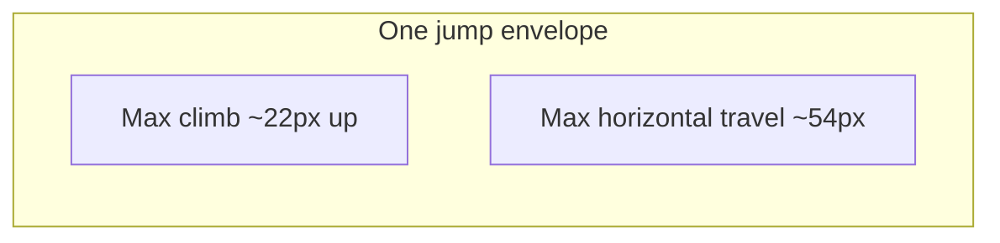
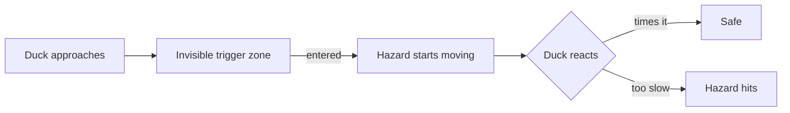
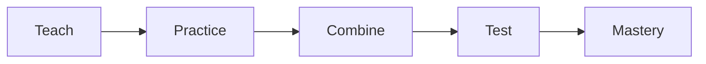

# Level Design

This page is written for anyone who wants to **shape a stage**: a designer, a
contributor tuning difficulty, or a developer adding new content. It explains
how stages are put together, the principles that keep them playable, and the
philosophy behind progression. No code — just the design model.

For the gameplay itself, see [Game Concepts](game-concepts.md); for the systems
that realize a stage, see [Components — Level Management](components.md).

## Level anatomy

Every stage is described by a single declarative definition that contains:

| Element | Purpose |
|---------|---------|
| **Platforms** | Solid surfaces the duck stands on and jumps between. |
| **Triggers** | Invisible rectangles that activate hazards when entered. |
| **Traps** | Hazards, each with a type, appearance, and behavior. |
| **Background** | The themed tilemap behind everything. |
| **Music** | The stage's audio track. |
| **Spawn point** | Where the duck appears at the start (and after death). |
| **Door** | The exit that advances the game. Sprite, animation, and facing are all overridable per stage - not always a literal door (World 5's finale uses this for a narrative goal marker instead). |
| **Intro hint** | Optional one-time text (28 characters at most) shown when the stage starts, until it has been cleared once. For teaching a mechanic at the moment it matters. |
| **World size** | Determines whether the camera scrolls and sets the duck's bounce edges. |

The same skeleton powers every world; only the contents and theme change.

### Where the level data lives

Each world's stages are a JSON file: `game/levels/world1.json` ...
`world5.json`. Every platform, trigger, trap and checkpoint is one line with
its fields by name (those of `PlatformData`, `TriggerData`, `TrapData`,
`CheckpointData` in `level_structure.h`); a field left out keeps its default,
and a `"note"` is the comment shown above the entry. Sprites are named by
their item (`"bubbles"`), trap types and trigger modes by their name
(`"MOVING"`, `"Toggle"`), shared paths and animation sequences by their
constant in `levels_common.h` (`"FIGURE_8_PATH"`).

`python3 tools/Generate_levels.py` turns the JSON into
`game/include/level/levels_worldN.h`, which the game compiles - never edit
those headers by hand. `make checks`, CI and a pre-commit hook fail when a
header does not match its JSON. The examples below are JSON entries.

## Coordinate system & orientation

Understanding the coordinate orientation is the key to placing anything:

- **Smaller Y = higher up.** Gravity increases Y; jumping decreases Y.
- The world is conceptually centered at the origin, and the camera shows a
  window into it.
- A stage whose world size matches the screen is single-screen; a wider world
  scrolls with the duck.

When you place platforms, think of Y as "height from the bottom": a platform at
Y = 60 sits near the floor of the visible area, while one at Y = −40 sits high
up.

## Platform placement principles

The most important design rule is **physics-derived spacing**. Because the
duck's movement envelope is fixed and known, every jumpable gap can be measured
in advance. A fully-held jump reaches roughly:



Based on the central movement configuration, a single fully-held jump can climb
about 22 pixels vertically and carry about 54 pixels horizontally. Descending is
essentially unconstrained in height as long as the duck stays above the death
height and the horizontal gap remains inside the same envelope.

To stay **provably clearable**, the established convention is:

- **Climbs ≤ 16px per jump.**
- **Horizontal gaps ≤ 40px per jump.**

Both limits are set well inside the *measured* envelope on purpose, so a
comfortable margin survives small tuning passes to `Cfg::Player` - the
envelope above already reflects the current values. A level's
`ground_friction` (see [Extensibility Guide](extensibility.md)) never
factors into this at all: it only scales how quickly the duck brakes while
grounded, never acceleration, gravity, or jump speed, so a slippery floor
can change how precisely a level plays without ever making a jump fall
short of a platform it used to reach.

These are deliberately *inside* the measured envelope (22 / 50), leaving a
comfort margin so the intended path is always achievable even with imperfect
input. Stays within these limits unless you explicitly want a risky, optional
leap.

### Dash and the envelope

From World 3 onward the duck can also dash (see
[Game Concepts](game-concepts.md#dash)). Dash only adds horizontal reach: a
flat ground dash covers 32px, and a jump plus a well-timed air dash reaches
roughly 100px horizontally (same-height edge-to-edge gaps: up to ~61px with a
jump alone, ~72px with a run-up and coyote time, ~103px with jump + dash,
measured with `tools/Check_level_reachability.py`, which re-implements the
per-frame movement), while the climb stays at ~22px. Consequences for
authoring:

- **Existing layouts stay valid.** The 16px climb and 40px gap rules still
  guarantee a dash-free route, so every level remains clearable without
  using the dash.
- **Dash can bypass hazards.** In levels with dash enabled, a long gap that
  was only a hazard-forced detour can now be crossed directly. Check that a
  shortcut like that is intended.
- **Dash-required gaps need a margin.** If a future level deliberately
  requires the dash, make the gap clearly bigger than a plain jump can ever cross (more than
  ~72px, so that coyote time and a run-up cannot cheat it) and well inside
  the dash envelope - 76-96px works, and the dash may then start anywhere in a
  window of 12+ frames after takeoff. Keep the climb at 16px or less, like
  every other jump.
- **Worlds 1-2 have no dash.** Their levels, including when replayed via
  Level Select, were authored for the plain jump envelope.

### Other placement guidelines

- **Lead with a safe landing.** Give the player a reliable platform to start
  from before demanding a tricky sequence.
- **Readability first.** A player should be able to see the hazard *and* the
  landing spot from the takeoff point.
- **Ground hazards in gaps.** Placing static hazards in the spaces *between*
  platforms turns a casual stroll into a deliberate jump — the gap becomes the
  challenge, not the platform itself.
- **Progressive complexity.** Start with simple hops, then layer in timing,
  then combine multiple hazards.

## Trap configuration patterns

Traps are configured declaratively. The recurring design patterns are:

### 1. The always-on sentry (Base trap)

A static hazard placed in a gap or on a ledge. Use it to punish sloppy
landings and to force deliberate jumps. Animated base traps (e.g. a mimic) add
"is it safe?" tension without moving.

### 2. The timed release (Moving trap + trigger)

A hazard that lies dormant until the duck steps into a trigger zone, then
accelerates. Classic uses:

- **Falling hazard:** placed above the path, drops when the duck is near.
- **Rising hazard:** placed below, rises to intercept a climb.
- **Charging hazard:** sweeps horizontally across a corridor.

The pattern's power is that the hazard's *timing* is authored by the trigger
placement, so the same falling brick can feel like a surprise or a telegraph
depending on where its trigger sits.

**Variant - in-level escalation.** When the same sprite/trap appears twice
in one level via two separate triggers, retune the later instance faster
than the earlier one (same sprite, same behavior, just tighter numbers) -
the player already met the pattern once, so the second copy can ask more
of them without needing new art or a new trap type.
`LEVEL_WORLD1_SCROLL` ("release1"/"release2" bubbles) and
`LEVEL_WORLD2_SCROLL` ("can_release1"/"can_release2" cans) both do this.
It's deliberately scoped to *within one world's own levels* - see
[Audio-visual theme integration](#audio-visual-theme-integration) for why
reusing a hazard sprite across different world themes is avoided instead.

### 3. The patrol (Path trap)

A hazard that sweeps a route defined by waypoints. Use it to guard a corridor or
to force the duck to time a crossing. Figure-8 and back-and-forth routes are
both supported. A patrol can be gated behind a trigger so it only starts once
the duck reaches the area it guards.

**Variant - two phase-offset patrols.** A second `PATH` trap can run the
*exact same route* as a first one, just starting from a different point in
the loop, by giving it a rotated copy of the same waypoint array (same
shape, same `path_waits`, same trigger, different starting index). The two
then sweep in lockstep but permanently out of phase, periodically crossing
rather than moving together - genuinely new difficulty from data alone, no
new path shape or trap type. `LEVEL_WORLD3_SCROLL` does this with
`LEVEL3_BRANCH_PATH` / `LEVEL3_BRANCH_PATH_PHASE2` (`levels_common.h`).
`LEVEL_WORLD1_BOSS` and `LEVEL_WORLD2_BOSS` both do it too, each with a
second patrol anchored further into the arena than the first, so patrol
pressure covers the whole fight instead of just the opening section -
`LEVEL_WORLD2_BOSS` reuses `LEVEL3_BRANCH_PATH_PHASE2` verbatim (same
shape World 3 already shares with World 2's idle patrol), and
`LEVEL_WORLD1_BOSS` adds a matching `FIGURE_8_PATH_PHASE2` for its bubble.

### 4. The pursuer (Chase trap)

A hazard that trails the duck and closes in as they advance, but never retreats.
This is a **pressure** mechanic: it punishes hesitation and standing still. It
turns an otherwise-safe run into a forced march and belongs in the most
intense, late-game stages. Because it ignores terrain, it flies freely over the
layout, so use it where the duck must keep running right. It doesn't have to
be boss-exclusive: `LEVEL_WORLD4_SCROLL_2` gives it a gentler first outing
(more follow distance, lower speed) alongside an `AMBUSH` bug, so the World 4
boss's much tighter chaser isn't the player's first time reading pursuit
pressure and a lunging dodge at the same time - see [The gauntlet](#6-the-gauntlet-boss-level)
below for how the boss escalates it. World 5 goes a step further and brings
the *same* pursuer back across all three of its levels: the axe introduced
in `LEVEL_WORLD5_SCROLL` returns tuned a notch tighter in
`LEVEL_WORLD5_SCROLL_2` (also its first pairing with that level's `AMBUSH`
mimic), then tighter again in `LEVEL_WORLD5_BOSS` - a three-step escalation
of one hazard across a whole world, purely from data.

### 5. The disguise (Ambush trap)

A hazard that looks static (and can animate, like a chest mimic) until the
duck gets within a configured range, at which point it lunges once and
retreats. Unlike the timed release, its activation isn't authored via a
trigger's placement - it's purely proximity, so the "reveal" always happens
relative to the duck's own approach rather than a fixed spot on the map.
Best used sparingly, among genuinely similar-looking static objects (a row
of chests, a cluster of bushes), so the player learns to treat the whole
group with caution rather than memorizing one exact tile.

### 6. The cycle (Cycle trap)

A hazard on its own clock: it moves out from its start position by
`(cycle_dx, cycle_dy)`, stays out, moves back and rests, again and again -
the classic spikes that rise out of the floor. A round is four frame counts
(`cycle_extend_frames`, `cycle_hold_frames`, `cycle_retract_frames`,
`cycle_wait_frames`); an extend or retract of 0 makes the spikes pop in or out
at once. `cycle_phase_frames` starts the trap that far into its round, so a
row of spikes with phases 0, 20, 40 ... forms a wave and two traps half a
round apart alternate. The duck learns the rhythm instead of reacting to a
trigger, which makes it the natural counterpart of the timed release.

With a `trigger_name` the trap only cycles while that trigger is on and freezes
where it is otherwise: a Timer trigger makes the cycle start a few seconds in,
a lever switches the spikes off (or on). Without one it cycles from the first
frame of the level. A death restarts every cycle from its phase.

**One stab only.** A `cycle_wait_frames` longer than any attempt (e.g. 36000,
ten minutes) turns the cycle into a one-shot: bound to a trigger it stabs once
when the trigger turns on, sinks back and stays hidden until the next death
restarts it. That is the end piece of a [delayed trap
chain](#delayed-trap-chains); no separate trap type is needed. Start it below
the screen or behind a platform (`sprite_z_order` 1) so it is not seen before.

```json
// spikes rise 12px out of the floor: 6 frames up, 30 up, 6 down, 60 resting;
// the second one starts half a round (51 frames) later
{"type": "CYCLE", "x": 40, "y": 66, "width": 16, "height": 12, "offset_x": 0, "offset_y": 0,
 "sprite": "rostybar32x32", "cycle_dy": -12, "cycle_extend_frames": 6, "cycle_hold_frames": 30,
 "cycle_retract_frames": 6, "cycle_wait_frames": 60},
{"type": "CYCLE", "x": 72, "y": 66, "width": 16, "height": 12, "offset_x": 0, "offset_y": 0,
 "sprite": "rostybar32x32", "cycle_dy": -12, "cycle_extend_frames": 6, "cycle_hold_frames": 30,
 "cycle_retract_frames": 6, "cycle_wait_frames": 60, "cycle_phase_frames": 51}
```

Keep the **rest** long enough to cross: the duck needs roughly `wait +
extend + retract` frames of safe time, and the hitbox of a rising trap is
dangerous from the first frame of the extend. Hard Mode and Assist Mode scale
all five numbers (a faster round in Hard Mode, a slower one in Assist Mode).
`Preview_level.py` draws the stroke and prints the timing; the checkpoint check
treats the whole stroke as the trap's path.

### 7. The gauntlet (Boss level)

A whole-level pattern, not a single trap: a flat, readable corridor with
several of the above patterns layered in sequence - a patrol hazard
running throughout, trigger-gated attacks fired in waves as the duck
advances, a mid-arena ambush punishing lingering, and (in the later
worlds) a chase hazard keeping forward momentum mandatory. Used for the
one boss level that closes out each world; see
[Game Concepts — Boss levels](game-concepts.md#boss-levels).

### The boss arena

Each boss level ends in an arena (data in the level JSON, built by the same
pattern in every world):

- A step 18 px up from the floor, the left ledge 36 px up (two pieces, the
  checkpoint and the `arena` trigger on it), a pit of 112 px (128 px for
  World 5), the right ledge with the door.
- The `BOSS` trap: `path` `BOSS_PATH` / `BOSS_PATH_WIDE` across the pit,
  `path_waits` frames per crossing in phase 1, `trigger_name` `arena`,
  `boss_hits`, its hitbox top 6 px below the ledges (a strike from a ledge
  jump reaches it) and `sprite_scale` 1.25 of a world trap's picture
  (`tools/Upscale_sprite.py` made 2x versions of 16 px pictures).
- Triggers `arena_p<n>` (out of reach, the boss switches them on) with
  MOVING traps that fall through the pit, and `arena_won` with the stepping
  stone platform it raises.
- A `CHASE` trap of the corridor gets a `chase_limit` so it stays out.
- `Check_level_reachability.py` counts `*_won` triggers as on (it assumes
  the fight is won); the replays in `game/replays/` prove the fights.

### Dash and switch levels

World 5 has two levels built on the newer mechanics; they double as worked
examples.

**Cloak Corridor** (`LEVEL_WORLD5_DASH`) - three gaps of 84-92px between
barrels, each with rusty bars in the pit so the gap reads as lethal, joined by
ordinary 28-40px hops. Without the dash it cannot be finished, even with a
perfect run-up. The axe chases from 48px behind at exactly walking speed - it
never catches a duck that keeps moving, but punishes stopping to think - and
an ambush mimic lurks in the gap between two short hops.

**Lever Hall** (`LEVEL_WORLD5_LEVERS`) - four Toggle levers and four switched
platforms in three rooms:

- *Room 1:* the 120px chasm is wider than even a dash, so `lever1` (which
  raises the bridge stone) is mandatory. Walking over the lever flips it once.
- *Room 2:* the stone in the 84px chasm is present by default and `lever2`
  removes it. The lever stands on the way: hop over it to keep the stone, or
  step on it and dash the 84px gap. Stepping on it a second time brings the
  stone back, so there is no dead end.
- *Room 3:* two stones over a 160px chasm, one per lever. Both on is a plain
  walk; one lever plus the dash (96px) also works; none is impossible.

Everything resets on death, so a puzzle always restarts from the same state.

**Hints.** The first dash level (World 3's first stage), "Cloak Corridor" and
"Lever Hall" each carry an `intro_hint`, so the player is told once what the
new mechanic needs. Hints are for *how to use* something, not for solving a
puzzle; they are limited to 28 ASCII characters (`tools/Check_level_hints.py`
checks this) and vanish after the first clear.

**Verifying levels.** Run `tools/Check_level_reachability.py` on a level: it
re-implements the duck's per-frame movement (same constants as `Cfg::Player`
and `Cfg::Dash`), simulates every combination of start position, jump,
direction release and dash timing from each platform, and reports which
platforms and the door are reachable - without the dash and with it, from a
conservative start (center exactly on the edge) and an optimistic one (already
past the edge with coyote time). For switch levels it explores every lever
configuration the duck can set from the platforms it has reached. A gap meant
to require the dash must fail the optimistic no-dash run and pass the
conservative dash run. The check ignores hazards, so traps still need a manual
look. All 22 current levels pass it conservatively with the abilities of
their world; "Cloak Corridor" needs the dash, "Bramble Hop" the pogo and
"Barrel Tower" the wall jump (each checked to fail without it). The pogo is
simulated off the level's BASE traps (they never move), only for levels the
check cannot finish without it. Wall jumps are simulated frame by frame
with a few climb policies: up a shaft between two walls, up a single wall.

### Fake doors and fake checkpoints

A hazard that looks like the real thing needs no new trap type: a static BASE
trap that wears the sprite of a door or a checkpoint kills on touch like any
other. The one missing piece was the draw order - the real door and checkpoint
stand behind the duck (`Cfg::ZOrder::DOOR` / `CHECKPOINT`, 1), a trap defaults
to the duck's own layer - so `sprite_z_order` (0 = unchanged) sets it, for
any trap type.

```json
// Fake door: the animation, the speed and the layer of the real one; the box
// covers the doorway, not the whole 32x32 sprite.
{"type": "BASE", "x": 140, "y": 40, "width": 10, "height": 20, "offset_x": 0, "offset_y": 0,
 "sprite": "door32x32", "sprite_waits": 8, "graphic_indexes": "DOOR32X32_GRAPHICS_INDEXES",
 "sprite_z_order": "Cfg::ZOrder::DOOR"},

// Fake checkpoint: the grey (not reached) flag, standing on a platform.
{"type": "BASE", "x": -60, "y": 44, "width": 10, "height": 16, "offset_x": 0, "offset_y": 0,
 "sprite": "checkpoint16x16", "sprite_z_order": "Cfg::ZOrder::CHECKPOINT"}
```

- Leave `offset_x` / `offset_y` at 0: a trap's sprite follows its collision box.
- The fake door is only convincing next to a level whose real door looks the
  same (`door32x32` with the default animation).
- Combine it with the other tools for the cruel version: a fake door in a
  dead end with a real door above it, a fake checkpoint before a long
  stretch, a CYCLE or MOVING trap bound to a trigger that fires when the duck
  *reaches* the fake (a trap's trigger zone can sit on top of it).
- Keep it fair: let the duck see the difference when it stops to look (a flag
  of the wrong colour, no light behind the door), and never put the only way
  forward behind an unmarked fake. `Check_checkpoints.py` only knows real
  checkpoints, so a fake one is not subject to its placement rules.
- The real door can lie too: see [False exits](#false-exits-the-door-that-turns-the-door-that-moves).

### The door that runs away

The Level Devil classic: the duck reaches the door and it slides away. Give
the level's `door` a `flee_path` (offsets from the door, like a PATH trap's
points), a `flee_range` and a `flee_frames`:

```json
"door": {"x": 96, "y": 30, "flee_path": [[0, -64], [-80, -64]],
         "flee_range": 24, "flee_frames": 12}
```

- Whenever the duck comes within `flee_range` px of the door (both axes), it
  slides to the next point in `flee_frames` frames. At the last point it stays
  and is an ordinary door. Touching it while it moves still counts.
- A death puts it back at its origin (`door_flee.h`, `Door::reset_flee()`).
- `Check_level_reachability.py` checks the **last** stop, so the route has to
  lead there. Every stop should be visible or reachable on the way - the joke
  is the door running, not a door that hides.

### False exits: the door that turns, the door that moves

Two more ways for the real door to lie, both on the level's `door`
(`door_logic.h`, host-tested in `tests/host/test_door_logic.cpp`):

```json
"door": {"x": 152, "y": 42,
         "trap_trigger_name": "door_trap",
         "attempt_positions": [[0, 0], [-96, -16]], "attempt_every": 3}
```

- **The door that turns into a trap.** `trap_trigger_name` names a trigger of
  the level. While it is on, touching the door kills the duck instead of
  finishing the level; while it is off the door is a door. Any trigger works:
  a zone right in front of the door, a Hold plate somewhere else, a Timer
  ("the door does not wait"), a delay. A death resets the trigger and with it
  the door - behind a checkpoint too: the checkpoint's snapshot of the
  triggers that were on never keeps this one. So the trap trigger must be the
  door's alone and must not follow another trigger: `Check_trigger_references.py`
  rejects one that also drives a trap, a platform or a follower (they would
  lose their checkpoint state with it) and one with `follows` (its source is
  restored and would re-arm the door after every respawn). **No tell:** the
  door looks exactly the same either way - as in Level Devil, the joke is
  that the safe door a moment ago is not safe now.
  The tell belongs to the trigger: give it a visible sprite (a lever drops
  the moment the duck steps on it) or make the rule learnable in one death.
- **The door that moves between attempts.** `attempt_positions` (offsets
  from `(x, y)`, a list of `[x, y]` pairs) and `attempt_every`: after every
  `attempt_every` deaths in this level the door stands at the next spot, the
  last one stays (`attempt_variant::variant_for_attempt()`). Make the first
  spot `[0, 0]` so the first attempt - and a recorded replay - is unchanged.
  A death, a checkpoint respawn and Restart Level all re-place it; the deaths
  count from entering the level, not over the whole run.
  `Generate_levels.py` refuses `attempt_positions` without an
  `attempt_every` >= 1.
- Both combine with the rest of the door: a `flee_path` runs from whichever
  spot the door stands on, a trapped door can run away, and a boss lock still
  hides the door (a locked door neither finishes nor kills).
- "Which door is real?": put [fake doors](#fake-doors-and-fake-checkpoints)
  at the spots the real door is not. Fakes that should swap places with the
  real door after deaths need `TrapData::from_death` / `until_death` (the
  same death count, `attempt_variant::active_for_deaths()`); the door's spots
  and the fakes' windows combine, so keep the same `attempt_every` rhythm.
- `Check_level_reachability.py` checks **every** spot (each with its flee
  path's last stop) and that none lies outside the play area;
  `Check_trigger_references.py` checks `trap_trigger_name` like any other
  trigger name and the rules above. Neither knows when the trap trigger is
  on: make sure there is a way to reach the door while it is off.
  `Preview_level.py` draws the
  later spots as dashed doors ("door after 3+").

`LEVEL_WORLD4_SCROLL_2` shows both: a lever on the last beet is a pressure
plate (Hold) with a 30-frame lag both ways. Hop across it and nothing
happens; stand on it and the lever drops, and the door kills the duck that
jumps over to it. After three deaths the door takes pity and waits one
flower earlier, before the lever.

### Lurking arms and runaway platforms

Two more ways for the level itself to go after the duck:

- **Lurking (vertical AMBUSH).** `"ambush_vertical": true` makes an AMBUSH
  trap lunge along y: put arms or spikes below the screen or inside a tall
  platform, `ambush_speed` negative (up), and they shoot out the moment the
  duck is within `ambush_range` horizontally, then sink back
  (`ambush_logic.h`). Fair only if the duck can see them coming or can keep
  running: a range a little wider than the trap lets a running duck through.
- **Runaway platform.** A platform with `flee_path` / `flee_range` /
  `flee_frames` (like the runaway door) slides on when the duck comes close -
  typically just as it jumps for it. `Check_level_reachability.py` checks
  the platform at its last stop, so the route has to work from there.

### Traps and platforms that change with every death

"After the 3rd death the trap sits somewhere else." Any platform or trap
(except a BOSS) can be limited to some attempts with `from_death` /
`until_death`: it is only there while the duck has died at least `from_death`
and fewer than `until_death` times in this visit of the level (`until_death`
0 = no end). Both 0, the default, means always there - every level without
them plays exactly as before.

```json
// the arms lurk under the first gap for the first three attempts ...
{"type": "AMBUSH", "x": -72, "y": 112, ..., "until_death": 3},
// ... and under the next one from the 3rd death on
{"type": "AMBUSH", "x": 80, "y": 112, ..., "from_death": 3}
```

- An object that is not there has no collision and no picture. A moved trap or
  platform is simply two entries that split at the same death (`until_death 3`
  / `from_death 3`), so exactly one of them is there on every attempt.
- The deaths count from the moment the level is loaded (`LevelManager::
  _deaths_in_level()`): leaving the level, the title screen or a new visit via
  Level Select start again at 0. Restart Level counts as a death, as it does
  for the death counter.
- The change happens when the duck respawns - after the death freeze, at the
  spawn or at the checkpoint - never in the middle of an attempt.
- It combines with the rest of the platform's behaviour: a switched platform
  that is there still follows its trigger, a crumbling or runaway one starts
  untouched. A platform that is not there stays gone whatever its trigger
  does.
- Not for a BOSS (its fight shows and hides it itself), and never empty
  (`until_death` <= `from_death`): `Generate_levels.py` rejects both, the level
  load asserts the first.
- Keep the first attempts identical to what the recorded replay
  (`game/replays/`) plays: a window that starts at 0 must not change the route
  the replay takes.
- The tools know about it: `Check_level_reachability.py` checks the door on
  every distinct set of objects (one check per death at which a window opens
  or closes), `Check_checkpoints.py` does not let a flag stand on a platform
  with a window and wants its platform reachable on every attempt,
  `Check_sprite_budget.py` counts every copy (all of them are created at load,
  the absent ones only hidden), and `Preview_level.py` labels them "deaths 3+"
  / "deaths 0-2".
- Fair play: the duck should be able to learn the new place from one death,
  as with any Level Devil trick. Trickwood (`LEVEL_WORLD3_TRICK`) moves its
  lurking arms one gap on after the 3rd death.

### Crumbling platforms

A platform reacts to the duck itself, without any trigger: set
`PlatformData::crumble_frames` (after `active_when_on`) and the platform gives
way that many frames after the duck first stands on it.

| Field | Meaning |
|-------|---------|
| `crumble_frames` | Frames from the first step until the platform gives way (1 or more; 0 = an ordinary platform). It shakes meanwhile and stays solid. |
| `crumble_respawn_frames` | Frames until it is back (0 = it stays gone until a death or Restart Level). |

- Stepping off or jumping away does not save it: once it has been touched, it
  falls. The crumble time is the margin the duck has to cross it.
- It falls out of the picture for about a third of a second (a visual only: it
  stops being solid the moment it starts to fall).
- A platform that comes back waits until the duck is not inside its box, as
  switched platforms do.
- Death and Restart Level put every crumbling platform back.
- A crumbling platform cannot also be switched by a trigger, and a checkpoint
  must not stand on one (`Check_checkpoints.py` reports both; the level load
  asserts the first).
- `Check_level_reachability.py` treats a crumbling platform as a solid one:
  the duck can always jump off before it falls, so reachability is unchanged.
  With `crumble_respawn_frames` 0 a way that has to be taken twice (back and
  forth) is gone the second time - check that by hand or give it a respawn.
- `Preview_level.py` draws them dotted with a "crumbles Nf" label.

```json
// gives way 30 frames after the first step, is back after 2 seconds
{"x": -48, "y": 60, "width": 32, "height": 8, "offset_x": 0, "offset_y": 0, "sprite": "nebel",
 "sprite_index": 0, "crumble_frames": 30, "crumble_respawn_frames": 120}
// a single-use stepping stone (never comes back)
{"x": 16, "y": 52, "width": 32, "height": 8, "offset_x": 0, "offset_y": 0, "sprite": "nebel",
 "sprite_index": 0, "crumble_frames": 20}
```

### Checkpoints

A long level or a boss can carry **one checkpoint**: a flag the duck touches
to respawn there instead of at the spawn point. It is plain level data:

```json
"checkpoints": {"name": "world3_boss_checkpoints", "items": [{"x": -80, "y": 48}]}
```

`(x, y)` is the center of the 16x16 flag AND the respawn position. Put the
flag's bottom on a platform's top: `y = platform top - 8` (the preview shows
each platform's top; `Preview_level.py` draws the flags in teal). A level has at
most `Cfg::Level::Limits::CHECKPOINTS` of them, and that is 1: the middle of the
level is the one place worth a retry point, more would turn the level into
several short ones. The code itself handles several flags (the limit is a
config value), so the rules below about order still hold if it is ever raised.

What a respawn does, and what to keep in mind when placing one:

- **Furthest one wins** (only matters with more than one flag). Touching an
  earlier flag again never moves the respawn back. Skipping a flag by jumping
  past it is fine.
- **Traps and triggers still reset on a death**, exactly as before - with one
  addition: the triggers that were ON when the checkpoint was reached (Latch and
  Toggle, not Hold) are switched on again after the respawn. That keeps a boss
  patrol or an already released attack running instead of leaving it dormant
  behind the flag. A released MOVING trap starts again from its start position,
  so it arrives a little later than in the run that reached the flag.
- **Chase traps start from their start position** (far behind a flag in the
  middle of a level), so the first seconds after a respawn are gentler than at
  the real spawn.
- **Keep the respawn clear of every trap and of its whole path.** The flag
  never stands in a trap, and never anywhere a trap can go: the full route of a
  PATH trap (the segments between its nodes, including the one that closes the
  loop), the track a MOVING trap takes once its trigger fires (a falling
  thwomp's column, a charging can's row), the row a CHASE trap sweeps to the
  right, and the lunge of an AMBUSH trap. The triggers that were on at the flag
  are re-armed after a respawn, so a trap on the flag's path would come for the
  duck again. A flag inside an ambush trap's range also lunges the trap right
  after the respawn; the checker errors on the lunge and warns on the range.
- **Some levels get no checkpoint at all.** The World 1 and World 2 bosses
  charge a pufferfish or a can along the whole floor, so there is no spot on
  any of their platforms that is clear of a trap's path.
- **No checkpoints in puzzle levels** like "Lever Hall": a death resets the
  levers, so a flag in the middle would only force the player to redo them.
- **Restart Level** (pause menu) clears the checkpoint and restarts from the
  spawn point; loading a level does too. A death still counts for the death
  counter and the no-death badge, and the level clock keeps running.

`tools/Check_checkpoints.py` verifies all of this on the level data: the flag
stands on a (non-switched) platform, the respawn box overlaps no platform or
trap or its path (see above), the platform is reachable from the spawn, plus
count, order and spacing. It runs in the Python CI job.

### Previewing levels

`tools/Preview_level.py` draws a level as an SVG picture (opens in any browser
or editor; no packages to install), so a layout can be judged without building
the ROM:

```bash
python3 tools/Preview_level.py LEVEL_WORLD5_DASH          # build/level_preview/LEVEL_WORLD5_DASH.svg
python3 tools/Preview_level.py levels_world5.h LEVEL_WORLD5_LEVERS -o lever.svg
python3 tools/Preview_level.py                            # every level + index.html
```

The picture uses the game's own coordinates (y points down, the world is
centered at 0,0, a dashed line marks every 240px "screen", the death line sits
at y = 100) and shows:

- **Platforms** in green when a plain jump reaches them, orange when only the
  dash does, red when nothing does - the same check as
  `Check_level_reachability.py`, over every lever configuration. Switched
  platforms are dashed and labelled `+lever` (solid while it is on) or `-lever`.
- **Jump arcs** between platforms from the same movement model: blue for plain
  jumps, dashed orange where only a dash gets across. `--arcs plain|none`
  speeds this up or hides it; `--optimistic` draws the optimistic start.
- **Triggers** with their mode (`[Toggle]`, `[Hold]`) and a dotted line to the
  traps they release.
- **Traps** by type: BASE as a box; MOVING with ghost boxes every 12 frames
  after its trigger fires (until it leaves the world); PATH with its route and
  nodes; CHASE with follow distance and speed; AMBUSH with its trigger band and
  the lunge.
- **Spawn**, **door** (sprite and hit box) and the level's intro hint.

Like the reachability check it draws hazards but does not judge their timing,
so fairness still needs play-testing. The Python CI job renders every level and
attaches the pictures to the run as the `level-previews` artifact.

## Trigger zones & their function

Triggers are the stage's **director**: they decide *when* things happen.

- Each moving/path trap references a trigger by its stable `name`. When the
  duck enters the trigger's rectangle, every trap bound to that name
  activates - so one trigger can fire several traps at once, which is how
  several levels pair a falling hazard with a patrol or a second hazard on
  the same cue. For hazards that follow each other *in time* see
  [Delayed trap chains](#delayed-trap-chains).
- A trigger can start **already active**, so its hazards move from the moment
  the stage loads — useful for a constant patrol the duck must dodge from the
  start.
- Triggers are invisible by design. Players never see them, so a stage should
  remain fair *without* relying on the player knowing where a hidden trigger is
  — the resulting hazard motion should read as natural, not arbitrary.

**Designing with triggers:**



A good trigger is placed so the resulting hazard is *visible and reactable* the
instant it activates — the duck should see it begin moving and have time to
respond.

### Trigger modes and switched platforms

A trigger has a **mode** that decides how entering and leaving its zone
changes its state:

| Mode | Behavior | Typical use |
|------|----------|-------------|
| **Latch** (default) | Turns on at the first entry and stays on until the next death/restart. | Everything authored so far: releasing a falling hazard. |
| **Toggle** | Every *entry* flips it; standing inside does not flip it again. | A switch the duck steps on and off again. |
| **Hold** | On only while the duck is inside. | A pressure plate. |
| **Timer** | Ignores the duck: turns on by itself `delay_frames` frames after the level (re)starts and stays on until the next death/restart. | A hazard that starts on its own clock, e.g. a patrol that wakes up after two seconds. |

Existing levels do not set a mode and keep Latch, so none of them changes.

### Jump and dash triggers

`TriggerData::action` (after `delay_frames`) decides what counts as "entering"
the zone:

| Action | The trigger fires when ... |
|--------|----------------------------|
| **Enter** (default) | the duck steps into the zone, as before. |
| **Jump** | the duck starts a jump while it is inside the zone. |
| **Dash** | the duck starts a dash while it is inside the zone. |

Everything else - the mode, the delay, the visible switch - works the same on
top of it: a Toggle with `Jump` flips on every jump inside it, a Hold plate with
`Jump` is pressed by a jump and released when the duck leaves. Walking through
such a zone does nothing, so it is invisible to a careful player and punishes a
reflexive one ("jumping here wakes the thwomp"). The Dash action only exists
from World 3 onward, where the dash is enabled; in Worlds 1-2 it never fires.
Place the zone so that the duck can only be inside it while it makes the
intended move, and give it a visible sprite or a hint when the level is meant to
be fair rather than cruel.

```json
// the brick above only falls when the duck jumps on this spot
{"x": 40, "y": 44, "width": 24, "height": 16, "name": "hop", "action": "Jump"}
```

### Delayed triggers

`TriggerData::delay_frames` (the last field, default 0) puts a lag between what
the duck does and what the traps and platforms bound to the trigger do:

- The delay applies in both directions: a Hold plate that is left keeps its
  hazard running for `delay_frames` more frames.
- A change that is undone before the delay has elapsed never shows (step on
  a Hold plate and off again within the delay, and nothing happens).
- A visible switch sprite flips at once - the duck sees its own action and
  feels the consequence later. An invisible trigger gives no hint at all, so
  use short delays (10-30 frames) for hazards the duck can still react to and
  long ones (60+ frames) for "what did I do?" surprises.
- For a **Timer** trigger the field is the timer length instead; it adds no
  extra lag. `delay_frames` 0 on a Timer trigger turns it on at the first
  frame.
- Death resets the delay and the timer. After a respawn at a checkpoint a
  trigger that was on when the flag was reached is on again at once (no
  delay), and a Timer that had not fired yet starts counting again.

```json
// a patrol that wakes up 3 seconds after the level starts
{"x": 600, "y": 0, "width": 8, "height": 8, "name": "wake", "mode": "Timer", "delay_frames": 180}
// a lever whose falling brick only drops half a second after the flip
{"x": -196, "y": 44, "width": 16, "height": 16, "name": "late", "mode": "Toggle",
 "sprite": "lever16x16", "delay_frames": 30}
```

### Delayed trap chains

One cue, several effects one after the other - the Level Devil classic: the duck
steps on a plate, the floor drops at once, and 40 frames later spikes shoot out
where it would land. `TriggerData::follows` (the last field, default none)
names another trigger of the same level; this trigger then **follows** it
instead of the duck:

- A follower ignores the duck (its zone, `mode` and `action` do nothing). It
  turns on when its source is **activated** - the source's state differs
  from the source's own `default_on` - and back off when the source returns
  to its default: a Toggle lever flipped back or a Hold plate left undoes the
  chain step by step, a Latch plate keeps it on until the next death. A source
  with `default_on: true` works the same way: its follower stays quiet at
  load and fires when the duck switches the source off. A follower itself
  must start off (`default_on: false`).
- Each hop costs **1 frame plus the follower's own `delay_frames`**:
  `plate -> drop (0) -> spikes (40)` fires the drop 1 frame after the plate and
  the spikes 41 frames after the drop. The order of the trigger array does not
  matter, and a follower can be the source of the next one (3, 4, ... hops).
  Several followers may share one source.
- Changes undone within a follower's delay never show, exactly as for the
  duck's own triggers.
- **Death** resets the whole chain. After a **checkpoint** respawn, every trigger
  that was on when the flag was reached is on again: a chain that had fully
  fired stays fired; a hop that was still counting starts again from the
  respawn (its source is on, so it fires 1 + delay frames later).
- `Check_trigger_references.py` fails on a `follows` that names no trigger of
  the level, a trigger that follows itself, a cycle (`a` follows `b`, `b`
  follows `a`) - nothing outside a cycle could ever start it - and a follower
  with `default_on: true`: fired, it would be off, and the checkpoint's
  snapshot only switches triggers back on, so it would fire again late after
  every respawn. Every follower is checked, unnamed ones too.
- Bind followers to **traps**, not to switched platforms:
  `Check_level_reachability.py` takes a platform's trigger for a lever the duck
  sets in its zone, which a follower never is, so `Check_trigger_references.py`
  rejects a platform bound to a follower. To open or close a platform with a
  chain, bind it to the chain's source.

For spikes that shoot out **once**, bind a Cycle trap to the chain's last
trigger and give it a rest longer than any attempt (see
[The cycle](#6-the-cycle-cycle-trap)). Lever Hall (World 5) has a 3-step
chain: an invisible plate on the gate stone, then a stab out of the landing
barrel 21 frames later and one out of lever2's barrel 31 frames after that.

```json
// plate -> the landing barrel stabs 21 frames later -> the next one 31 after that
{"x": -124, "y": 44, "width": 16, "height": 16, "name": "stone_plate"},
{"x": -48, "y": 44, "width": 16, "height": 16, "name": "landing_stab",
 "delay_frames": 20, "follows": "stone_plate"},
{"x": -16, "y": 44, "width": 16, "height": 16, "name": "lever_stab",
 "delay_frames": 30, "follows": "landing_stab"}
```

Two overlapping zones with different delays fake the same thing, but break as
soon as the duck enters them in a different order; a chain cannot.

A trigger can also have an optional **visible sprite** with an "off" and an
"on" tile, so a switch reads as a switch. Without one it stays invisible,
like every trigger so far.

A **switched platform** is a platform bound to a trigger by name
(`PlatformData::trigger_name`). While the trigger is on it is solid and
visible if `active_when_on` is true, or gone if it is false. Two platforms
bound to the same Toggle trigger with opposite `active_when_on` values give
the classic "this switch opens path A and closes path B". Traps bound to the
same trigger still follow it: a patrol (Path trap) pauses while its trigger
is off, so a switch can also freeze or release a hazard. A Moving trap only
stops accelerating while its trigger is off - it keeps its current momentum -
so prefer Path traps and platforms for switch puzzles.

Authoring notes:

- **Everything resets on death.** Triggers return to their default state and
  switched platforms follow, so a puzzle always starts the same way.
- **A platform never appears inside the duck.** It stays out until the duck
  has stepped clear, then appears.
- **Keep the switch reachable and readable.** Give it a visible sprite, put
  it where the duck can see what it changes, and keep every jump inside the
  physics envelope in both switch states.
- **Budgets.** A visible switch uses one sprite slot (the registry holds 72)
  and two tile sets; the trigger limit (16) and platform limit (32) are
  unchanged.
- **The level-data check covers platforms.** `Check_trigger_references.py`
  also fails on a platform whose `trigger_name` matches no trigger in its
  level.

## Audio-visual theme integration

Each world is a coherent theme that ties visuals and audio together:

| World | Theme | Background | Themed hazards |
|-------|-------|-----------|----------------|
| 1 | Ocean | Underwater tilemap | Bubbles |
| 2 | Factory | Industrial tilemap | Pipes, cans, rusty nails |
| 3 | Forest | Misty forest tilemap | Mushrooms, slither arms, branches |
| 4 | Garden | Bright garden tilemap | Nests, bushes, bugs, bricks |
| 5 | Dungeon | Dark dungeon tilemap | Barrels, bars, chests, levers, mimics, axes, thwomps |

When designing a stage, pick hazards that *belong* to the theme. A factory stage
with ocean bubbles breaks immersion. The goal is that a player who sees a frame
can tell which world they are in — background, platform art, hazard art, and
music all reinforcing one identity. See [Asset Management](asset-management.md)
for how these assets are organized.

## Level progression design philosophy

The stage sequence is designed as a **difficulty and complexity ramp**:



1. **Teach.** Early stages introduce one idea at a time — a simple gap, a single
   falling hazard. Forgiving layouts let the player learn the controls.
2. **Practice.** Next stages repeat the idea in slightly new contexts so the
   player builds muscle memory.
3. **Combine.** Mid stages combine multiple mechanics — timing a patrol while
   jumping a gap.
4. **Test.** Later stages introduce new hazards and tighter spacing that test
   everything learned.
5. **Mastery.** The final stage (dungeon) combines the full hazard vocabulary —
   static hazards, an animated mimic, a triggered thwomp, and a relentless
   chasing axe — into a climactic gauntlet.
6. **Release.** After mastery, one last stage deliberately breaks the ramp:
   World 5's finale is a trap-free walk to a reunion with Susanne. It isn't
   a difficulty step at all - it's a resolution, giving the player a beat
   to come down from the boss before the kiss scene.

### Guiding principles

- **Forgiving retries.** Death is cheap, so stages can be challenging without
  being punishing. Encourage experimentation.
- **Short, readable stages.** Each stage should be memorizable in a few
  attempts, rewarding pattern recognition.
- **A consistent difficulty curve.** Difficulty rises across the world sequence,
  not randomly, so the player always feels the challenge growing fairly.
- **Thematic escalation.** Later worlds feel more dangerous both mechanically
  and visually, matching the rising difficulty.

## A design workflow (conceptual)

1. **Sketch the path.** Decide the route from spawn to door and where the
   challenges sit.
2. **Lay platforms** within the physics envelope (climbs ≤ 16px, gaps ≤ 40px).
3. **Place the door** at the end of the path.
4. **Add triggers** at the moments you want hazards to fire.
5. **Assign traps** to each trigger (or leave them always-on), themed to the
   world.
6. **Set the world size** to make it single-screen or scrolling.
7. **Pick the background and music** for the theme.
8. **Test the clearability** — verify every required jump is achievable and every
   hazard is visible and reactable.

See [Extensibility Guide](extensibility.md) for the concrete steps to register
a new stage into the game.

## Related
- [Index](index.md)
- [Game Concepts](game-concepts.md)
- [Components](components.md)
- [Asset Management](asset-management.md)
- [Extensibility Guide](extensibility.md)
- [Glossary](glossary.md)