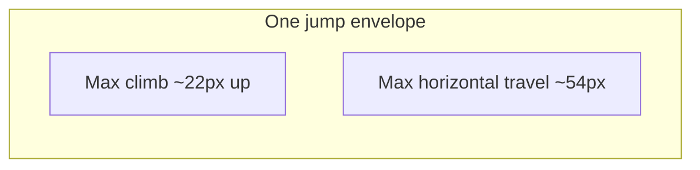
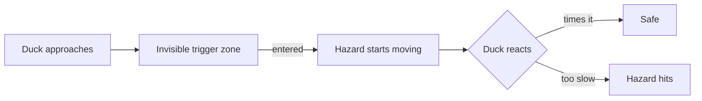
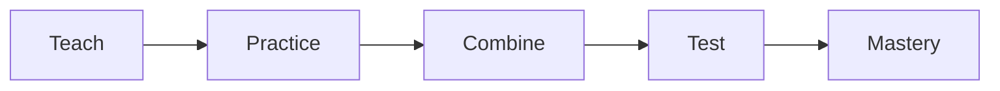

# Level Design

This page is written for anyone who wants to **shape a stage**: a designer, a
contributor tuning difficulty, or a developer adding new content. It explains
how stages are put together, the principles that keep them playable, and the
philosophy behind progression. No code — just the design model.

For the gameplay itself, see [Game Concepts](game-concepts.md); for the systems
that realize a stage, see [Components — Level Management](components.md).

## Level anatomy

Every stage is described by a single declarative definition that contains:

| Element | Purpose |
|---------|---------|
| **Platforms** | Solid surfaces the duck stands on and jumps between. |
| **Triggers** | Invisible rectangles that activate hazards when entered. |
| **Traps** | Hazards, each with a type, appearance, and behavior. |
| **Background** | The themed tilemap behind everything. |
| **Music** | The stage's audio track. |
| **Spawn point** | Where the duck appears at the start (and after death). |
| **Door** | The exit that advances the game. Sprite, animation, and facing are all overridable per stage - not always a literal door (World 5's finale uses this for a narrative goal marker instead). |
| **Intro hint** | Optional one-time text (28 characters at most) shown when the stage starts, until it has been cleared once. For teaching a mechanic at the moment it matters. |
| **World size** | Determines whether the camera scrolls and sets the duck's bounce edges. |

The same skeleton powers every world; only the contents and theme change.

## Coordinate system & orientation

Understanding the coordinate orientation is the key to placing anything:

- **Smaller Y = higher up.** Gravity increases Y; jumping decreases Y.
- The world is conceptually centered at the origin, and the camera shows a
  window into it.
- A stage whose world size matches the screen is single-screen; a wider world
  scrolls with the duck.

When you place platforms, think of Y as "height from the bottom": a platform at
Y = 60 sits near the floor of the visible area, while one at Y = −40 sits high
up.

## Platform placement principles

The most important design rule is **physics-derived spacing**. Because the
duck's movement envelope is fixed and known, every jumpable gap can be measured
in advance. A fully-held jump reaches roughly:



Based on the central movement configuration, a single fully-held jump can climb
about 22 pixels vertically and carry about 54 pixels horizontally. Descending is
essentially unconstrained in height as long as the duck stays above the death
height and the horizontal gap remains inside the same envelope.

To stay **provably clearable**, the established convention is:

- **Climbs ≤ 16px per jump.**
- **Horizontal gaps ≤ 40px per jump.**

Both limits are set well inside the *measured* envelope on purpose, so a
comfortable margin survives small tuning passes to `Cfg::Player` - the
envelope above already reflects the current values. A level's
`ground_friction` (see [Extensibility Guide](extensibility.md)) never
factors into this at all: it only scales how quickly the duck brakes while
grounded, never acceleration, gravity, or jump speed, so a slippery floor
can change how precisely a level plays without ever making a jump fall
short of a platform it used to reach.

These are deliberately *inside* the measured envelope (22 / 50), leaving a
comfort margin so the intended path is always achievable even with imperfect
input. Stays within these limits unless you explicitly want a risky, optional
leap.

### Dash and the envelope

From World 3 onward the duck can also dash (see
[Game Concepts](game-concepts.md#dash)). Dash only adds horizontal reach: a
flat ground dash covers 32px, and a jump plus a well-timed air dash reaches
roughly 100px horizontally (same-height edge-to-edge gaps: up to ~61px with a
jump alone, ~72px with a run-up and coyote time, ~103px with jump + dash,
measured with `tools/Check_level_reachability.py`, which re-implements the
per-frame movement), while the climb stays at ~22px. Consequences for
authoring:

- **Existing layouts stay valid.** The 16px climb and 40px gap rules still
  guarantee a dash-free route, so every level remains clearable without
  using the dash.
- **Dash can bypass hazards.** In levels with dash enabled, a long gap that
  was only a hazard-forced detour can now be crossed directly. Check that a
  shortcut like that is intended.
- **Dash-required gaps need a margin.** If a future level deliberately
  requires the dash, make the gap clearly bigger than a plain jump can ever cross (more than
  ~72px, so that coyote time and a run-up cannot cheat it) and well inside
  the dash envelope - 76-96px works, and the dash may then start anywhere in a
  window of 12+ frames after takeoff. Keep the climb at 16px or less, like
  every other jump.
- **Worlds 1-2 have no dash.** Their levels, including when replayed via
  Level Select, were authored for the plain jump envelope.

### Other placement guidelines

- **Lead with a safe landing.** Give the player a reliable platform to start
  from before demanding a tricky sequence.
- **Readability first.** A player should be able to see the hazard *and* the
  landing spot from the takeoff point.
- **Ground hazards in gaps.** Placing static hazards in the spaces *between*
  platforms turns a casual stroll into a deliberate jump — the gap becomes the
  challenge, not the platform itself.
- **Progressive complexity.** Start with simple hops, then layer in timing,
  then combine multiple hazards.

## Trap configuration patterns

Traps are configured declaratively. The recurring design patterns are:

### 1. The always-on sentry (Base trap)

A static hazard placed in a gap or on a ledge. Use it to punish sloppy
landings and to force deliberate jumps. Animated base traps (e.g. a mimic) add
"is it safe?" tension without moving.

### 2. The timed release (Moving trap + trigger)

A hazard that lies dormant until the duck steps into a trigger zone, then
accelerates. Classic uses:

- **Falling hazard:** placed above the path, drops when the duck is near.
- **Rising hazard:** placed below, rises to intercept a climb.
- **Charging hazard:** sweeps horizontally across a corridor.

The pattern's power is that the hazard's *timing* is authored by the trigger
placement, so the same falling brick can feel like a surprise or a telegraph
depending on where its trigger sits.

**Variant - in-level escalation.** When the same sprite/trap appears twice
in one level via two separate triggers, retune the later instance faster
than the earlier one (same sprite, same behavior, just tighter numbers) -
the player already met the pattern once, so the second copy can ask more
of them without needing new art or a new trap type.
`LEVEL_WORLD1_SCROLL` ("release1"/"release2" bubbles) and
`LEVEL_WORLD2_SCROLL` ("can_release1"/"can_release2" cans) both do this.
It's deliberately scoped to *within one world's own levels* - see
[Audio-visual theme integration](#audio-visual-theme-integration) for why
reusing a hazard sprite across different world themes is avoided instead.

### 3. The patrol (Path trap)

A hazard that sweeps a route defined by waypoints. Use it to guard a corridor or
to force the duck to time a crossing. Figure-8 and back-and-forth routes are
both supported. A patrol can be gated behind a trigger so it only starts once
the duck reaches the area it guards.

**Variant - two phase-offset patrols.** A second `PATH` trap can run the
*exact same route* as a first one, just starting from a different point in
the loop, by giving it a rotated copy of the same waypoint array (same
shape, same `path_waits`, same trigger, different starting index). The two
then sweep in lockstep but permanently out of phase, periodically crossing
rather than moving together - genuinely new difficulty from data alone, no
new path shape or trap type. `LEVEL_WORLD3_SCROLL` does this with
`LEVEL3_BRANCH_PATH` / `LEVEL3_BRANCH_PATH_PHASE2` (`levels_common.h`).
`LEVEL_WORLD1_BOSS` and `LEVEL_WORLD2_BOSS` both do it too, each with a
second patrol anchored further into the arena than the first, so patrol
pressure covers the whole fight instead of just the opening section -
`LEVEL_WORLD2_BOSS` reuses `LEVEL3_BRANCH_PATH_PHASE2` verbatim (same
shape World 3 already shares with World 2's idle patrol), and
`LEVEL_WORLD1_BOSS` adds a matching `FIGURE_8_PATH_PHASE2` for its bubble.

### 4. The pursuer (Chase trap)

A hazard that trails the duck and closes in as they advance, but never retreats.
This is a **pressure** mechanic: it punishes hesitation and standing still. It
turns an otherwise-safe run into a forced march and belongs in the most
intense, late-game stages. Because it ignores terrain, it flies freely over the
layout, so use it where the duck must keep running right. It doesn't have to
be boss-exclusive: `LEVEL_WORLD4_SCROLL_2` gives it a gentler first outing
(more follow distance, lower speed) alongside an `AMBUSH` bug, so the World 4
boss's much tighter chaser isn't the player's first time reading pursuit
pressure and a lunging dodge at the same time - see [The gauntlet](#6-the-gauntlet-boss-level)
below for how the boss escalates it. World 5 goes a step further and brings
the *same* pursuer back across all three of its levels: the axe introduced
in `LEVEL_WORLD5_SCROLL` returns tuned a notch tighter in
`LEVEL_WORLD5_SCROLL_2` (also its first pairing with that level's `AMBUSH`
mimic), then tighter again in `LEVEL_WORLD5_BOSS` - a three-step escalation
of one hazard across a whole world, purely from data.

### 5. The disguise (Ambush trap)

A hazard that looks static (and can animate, like a chest mimic) until the
duck gets within a configured range, at which point it lunges once and
retreats. Unlike the timed release, its activation isn't authored via a
trigger's placement - it's purely proximity, so the "reveal" always happens
relative to the duck's own approach rather than a fixed spot on the map.
Best used sparingly, among genuinely similar-looking static objects (a row
of chests, a cluster of bushes), so the player learns to treat the whole
group with caution rather than memorizing one exact tile.

### 6. The gauntlet (Boss level)

A whole-level pattern, not a single trap: a flat, readable corridor with
several of the above patterns layered in sequence - a patrol hazard
running throughout, trigger-gated attacks fired in waves as the duck
advances, a mid-arena ambush punishing lingering, and (in the later
worlds) a chase hazard keeping forward momentum mandatory. Used for the
one boss level that closes out each world; see
[Game Concepts — Boss levels](game-concepts.md#boss-levels).

### Dash and switch levels

World 5 has two levels built on the newer mechanics; they double as worked
examples.

**Cloak Corridor** (`LEVEL_WORLD5_DASH`) - three gaps of 84-92px between
barrels, each with rusty bars in the pit so the gap reads as lethal, joined by
ordinary 28-40px hops. Without the dash it cannot be finished, even with a
perfect run-up. The axe chases from 48px behind at exactly walking speed - it
never catches a duck that keeps moving, but punishes stopping to think - and
an ambush mimic lurks in the gap between two short hops.

**Lever Hall** (`LEVEL_WORLD5_LEVERS`) - four Toggle levers and four switched
platforms in three rooms:

- *Room 1:* the 120px chasm is wider than even a dash, so `lever1` (which
  raises the bridge stone) is mandatory. Walking over the lever flips it once.
- *Room 2:* the stone in the 84px chasm is present by default and `lever2`
  removes it. The lever stands on the way: hop over it to keep the stone, or
  step on it and dash the 84px gap. Stepping on it a second time brings the
  stone back, so there is no dead end.
- *Room 3:* two stones over a 160px chasm, one per lever. Both on is a plain
  walk; one lever plus the dash (96px) also works; none is impossible.

Everything resets on death, so a puzzle always restarts from the same state.

**Hints.** The first dash level (World 3's first stage), "Cloak Corridor" and
"Lever Hall" each carry an `intro_hint`, so the player is told once what the
new mechanic needs. Hints are for *how to use* something, not for solving a
puzzle; they are limited to 28 ASCII characters (`tools/Check_level_hints.py`
checks this) and vanish after the first clear.

**Verifying levels.** Run `tools/Check_level_reachability.py` on a level: it
re-implements the duck's per-frame movement (same constants as `Cfg::Player`
and `Cfg::Dash`), simulates every combination of start position, jump,
direction release and dash timing from each platform, and reports which
platforms and the door are reachable - without the dash and with it, from a
conservative start (center exactly on the edge) and an optimistic one (already
past the edge with coyote time). For switch levels it explores every lever
configuration the duck can set from the platforms it has reached. A gap meant
to require the dash must fail the optimistic no-dash run and pass the
conservative dash run. The check ignores hazards, so traps still need a manual
look. All 19 current levels pass it conservatively, and 18 of them without the
dash.

### Checkpoints

A long level or a boss can carry a few **checkpoints**: flags the duck touches
to respawn there instead of at the spawn point. They are plain level data:

```cpp
constexpr CheckpointData world1_boss_checkpoints[] = {{-24, 48}};
// ... at the end of the LevelData literal, after ground_friction and intro_hint:
//     world1_boss_checkpoints, sizeof(world1_boss_checkpoints) / sizeof(...[0])
```

`(x, y)` is the center of the 16x16 flag AND the respawn position. Put the
flag's bottom on a platform's top: `y = platform top - 8` (the preview shows
each platform's top; `Preview_level.py` draws the flags in teal). List a level's
checkpoints in the order it is played, at most `Cfg::Level::Limits::CHECKPOINTS`
(4).

What a respawn does, and what to keep in mind when placing one:

- **Furthest one wins.** Touching an earlier flag again never moves the
  respawn back. Skipping a flag by jumping past it is fine.
- **Traps and triggers still reset on a death**, exactly as before - with one
  addition: the triggers that were ON when the checkpoint was reached (Latch and
  Toggle, not Hold) are switched on again after the respawn. That keeps a boss
  patrol or an already released attack running instead of leaving it dormant
  behind the flag. A released MOVING trap starts again from its start position,
  so it arrives a little later than in the run that reached the flag.
- **Chase traps start from their start position** (far behind a flag in the
  middle of a level), so the first seconds after a respawn are gentler than at
  the real spawn.
- **Keep the respawn clear of ambush traps.** A flag inside an ambush trap's
  range lunges the trap right after the respawn; inside its lunge it is a
  guaranteed hit. The checker errors on the second and warns on the first.
- **No checkpoints in puzzle levels** like "Lever Hall": a death resets the
  levers, so a flag in the middle would only force the player to redo them.
- **Restart Level** (pause menu) clears the checkpoint and restarts from the
  spawn point; loading a level does too. A death still counts for the death
  counter and the no-death badge, and the level clock keeps running.

`tools/Check_checkpoints.py` verifies all of this on the level data: the flag
stands on a (non-switched) platform, the respawn box overlaps no platform or
trap (including a PATH trap's route and an ambush lunge), the platform is
reachable from the spawn, plus count, order and spacing. It runs in the Python CI
job.

### Previewing levels

`tools/Preview_level.py` draws a level as an SVG picture (opens in any browser
or editor; no packages to install), so a layout can be judged without building
the ROM:

```bash
python3 tools/Preview_level.py LEVEL_WORLD5_DASH          # build/level_preview/LEVEL_WORLD5_DASH.svg
python3 tools/Preview_level.py levels_world5.h LEVEL_WORLD5_LEVERS -o lever.svg
python3 tools/Preview_level.py                            # every level + index.html
```

The picture uses the game's own coordinates (y points down, the world is
centered at 0,0, a dashed line marks every 240px "screen", the death line sits
at y = 100) and shows:

- **Platforms** in green when a plain jump reaches them, orange when only the
  dash does, red when nothing does - the same check as
  `Check_level_reachability.py`, over every lever configuration. Switched
  platforms are dashed and labelled `+lever` (solid while it is on) or `-lever`.
- **Jump arcs** between platforms from the same movement model: blue for plain
  jumps, dashed orange where only a dash gets across. `--arcs plain|none`
  speeds this up or hides it; `--optimistic` draws the optimistic start.
- **Triggers** with their mode (`[Toggle]`, `[Hold]`) and a dotted line to the
  traps they release.
- **Traps** by type: BASE as a box; MOVING with ghost boxes every 12 frames
  after its trigger fires (until it leaves the world); PATH with its route and
  nodes; CHASE with follow distance and speed; AMBUSH with its trigger band and
  the lunge.
- **Spawn**, **door** (sprite and hit box) and the level's intro hint.

Like the reachability check it draws hazards but does not judge their timing,
so fairness still needs play-testing. The Python CI job renders every level and
attaches the pictures to the run as the `level-previews` artifact.

## Trigger zones & their function

Triggers are the stage's **director**: they decide *when* things happen.

- Each moving/path trap references a trigger by its stable `name`. When the
  duck enters the trigger's rectangle, every trap bound to that name
  activates - so one trigger can fire several traps at once (a **trigger
  chain**), which is how several levels pair a falling hazard with a patrol
  or a second hazard on the same cue.
- A trigger can start **already active**, so its hazards move from the moment
  the stage loads — useful for a constant patrol the duck must dodge from the
  start.
- Triggers are invisible by design. Players never see them, so a stage should
  remain fair *without* relying on the player knowing where a hidden trigger is
  — the resulting hazard motion should read as natural, not arbitrary.

**Designing with triggers:**



A good trigger is placed so the resulting hazard is *visible and reactable* the
instant it activates — the duck should see it begin moving and have time to
respond.

### Trigger modes and switched platforms

A trigger has a **mode** that decides how entering and leaving its zone
changes its state:

| Mode | Behavior | Typical use |
|------|----------|-------------|
| **Latch** (default) | Turns on at the first entry and stays on until the next death/restart. | Everything authored so far: releasing a falling hazard. |
| **Toggle** | Every *entry* flips it; standing inside does not flip it again. | A switch the duck steps on and off again. |
| **Hold** | On only while the duck is inside. | A pressure plate. |

Existing levels do not set a mode and keep Latch, so none of them changes.

A trigger can also have an optional **visible sprite** with an "off" and an
"on" tile, so a switch reads as a switch. Without one it stays invisible,
like every trigger so far.

A **switched platform** is a platform bound to a trigger by name
(`PlatformData::trigger_name`). While the trigger is on it is solid and
visible if `active_when_on` is true, or gone if it is false. Two platforms
bound to the same Toggle trigger with opposite `active_when_on` values give
the classic "this switch opens path A and closes path B". Traps bound to the
same trigger still follow it: a patrol (Path trap) pauses while its trigger
is off, so a switch can also freeze or release a hazard. A Moving trap only
stops accelerating while its trigger is off - it keeps its current momentum -
so prefer Path traps and platforms for switch puzzles.

Authoring notes:

- **Everything resets on death.** Triggers return to their default state and
  switched platforms follow, so a puzzle always starts the same way.
- **A platform never appears inside the duck.** It stays out until the duck
  has stepped clear, then appears.
- **Keep the switch reachable and readable.** Give it a visible sprite, put
  it where the duck can see what it changes, and keep every jump inside the
  physics envelope in both switch states.
- **Budgets.** A visible switch uses one sprite slot (the registry holds 72)
  and two tile sets; the trigger limit (16) and platform limit (32) are
  unchanged.
- **The level-data check covers platforms.** `Check_trigger_references.py`
  also fails on a platform whose `trigger_name` matches no trigger in its
  level.

## Audio-visual theme integration

Each world is a coherent theme that ties visuals and audio together:

| World | Theme | Background | Themed hazards |
|-------|-------|-----------|----------------|
| 1 | Ocean | Underwater tilemap | Bubbles |
| 2 | Factory | Industrial tilemap | Pipes, cans, rusty nails |
| 3 | Forest | Misty forest tilemap | Mushrooms, slither arms, branches |
| 4 | Garden | Bright garden tilemap | Nests, bushes, bugs, bricks |
| 5 | Dungeon | Dark dungeon tilemap | Barrels, bars, chests, levers, mimics, axes, thwomps |

When designing a stage, pick hazards that *belong* to the theme. A factory stage
with ocean bubbles breaks immersion. The goal is that a player who sees a frame
can tell which world they are in — background, platform art, hazard art, and
music all reinforcing one identity. See [Asset Management](asset-management.md)
for how these assets are organized.

## Level progression design philosophy

The stage sequence is designed as a **difficulty and complexity ramp**:



1. **Teach.** Early stages introduce one idea at a time — a simple gap, a single
   falling hazard. Forgiving layouts let the player learn the controls.
2. **Practice.** Next stages repeat the idea in slightly new contexts so the
   player builds muscle memory.
3. **Combine.** Mid stages combine multiple mechanics — timing a patrol while
   jumping a gap.
4. **Test.** Later stages introduce new hazards and tighter spacing that test
   everything learned.
5. **Mastery.** The final stage (dungeon) combines the full hazard vocabulary —
   static hazards, an animated mimic, a triggered thwomp, and a relentless
   chasing axe — into a climactic gauntlet.
6. **Release.** After mastery, one last stage deliberately breaks the ramp:
   World 5's finale is a trap-free walk to a reunion with Susanne. It isn't
   a difficulty step at all - it's a resolution, giving the player a beat
   to come down from the boss before the kiss scene.

### Guiding principles

- **Forgiving retries.** Death is cheap, so stages can be challenging without
  being punishing. Encourage experimentation.
- **Short, readable stages.** Each stage should be memorizable in a few
  attempts, rewarding pattern recognition.
- **A consistent difficulty curve.** Difficulty rises across the world sequence,
  not randomly, so the player always feels the challenge growing fairly.
- **Thematic escalation.** Later worlds feel more dangerous both mechanically
  and visually, matching the rising difficulty.

## A design workflow (conceptual)

1. **Sketch the path.** Decide the route from spawn to door and where the
   challenges sit.
2. **Lay platforms** within the physics envelope (climbs ≤ 16px, gaps ≤ 40px).
3. **Place the door** at the end of the path.
4. **Add triggers** at the moments you want hazards to fire.
5. **Assign traps** to each trigger (or leave them always-on), themed to the
   world.
6. **Set the world size** to make it single-screen or scrolling.
7. **Pick the background and music** for the theme.
8. **Test the clearability** — verify every required jump is achievable and every
   hazard is visible and reactable.

See [Extensibility Guide](extensibility.md) for the concrete steps to register
a new stage into the game.

## Related
- [Index](index.md)
- [Game Concepts](game-concepts.md)
- [Components](components.md)
- [Asset Management](asset-management.md)
- [Extensibility Guide](extensibility.md)
- [Glossary](glossary.md)